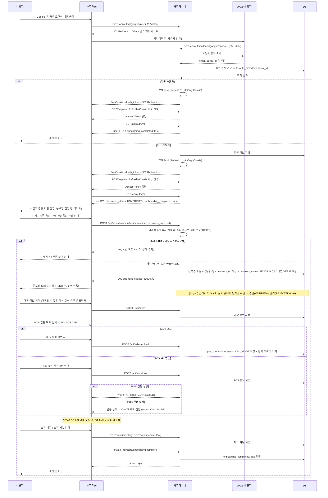
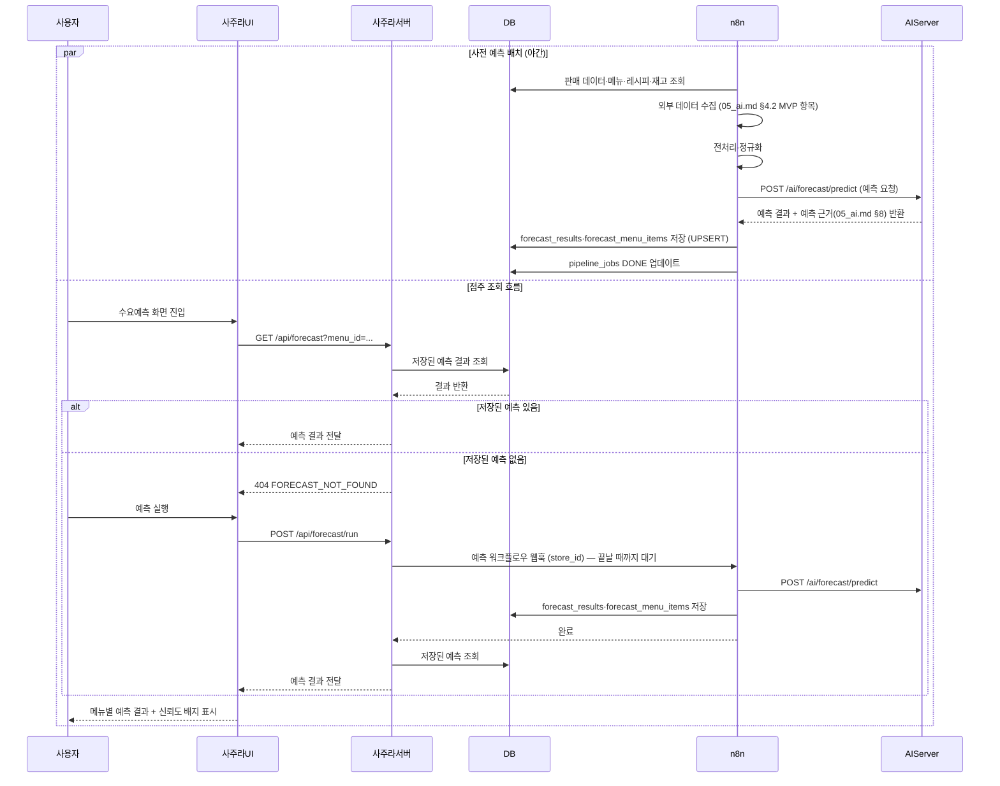
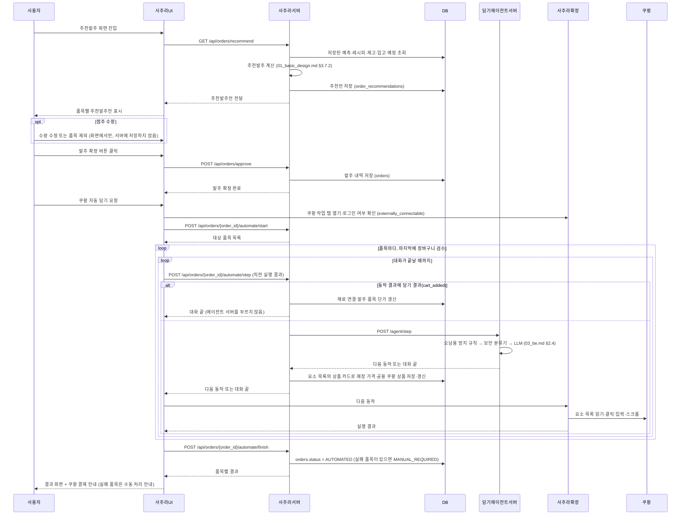
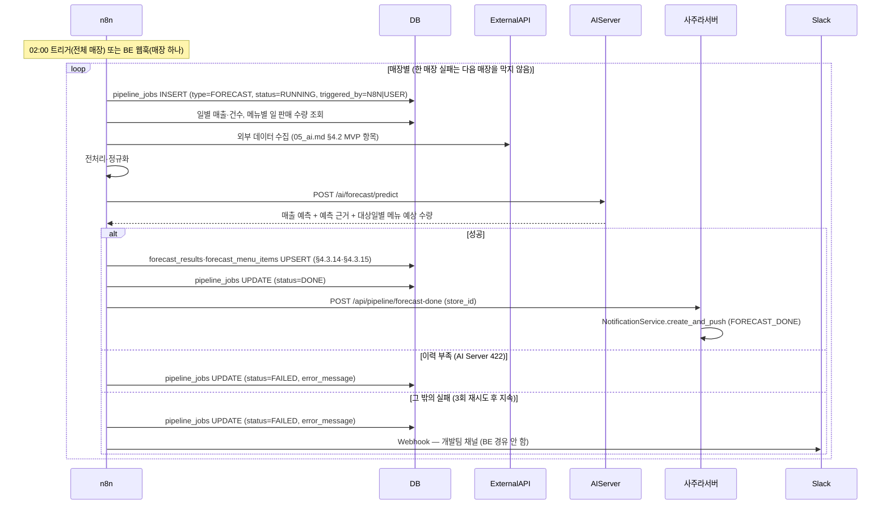
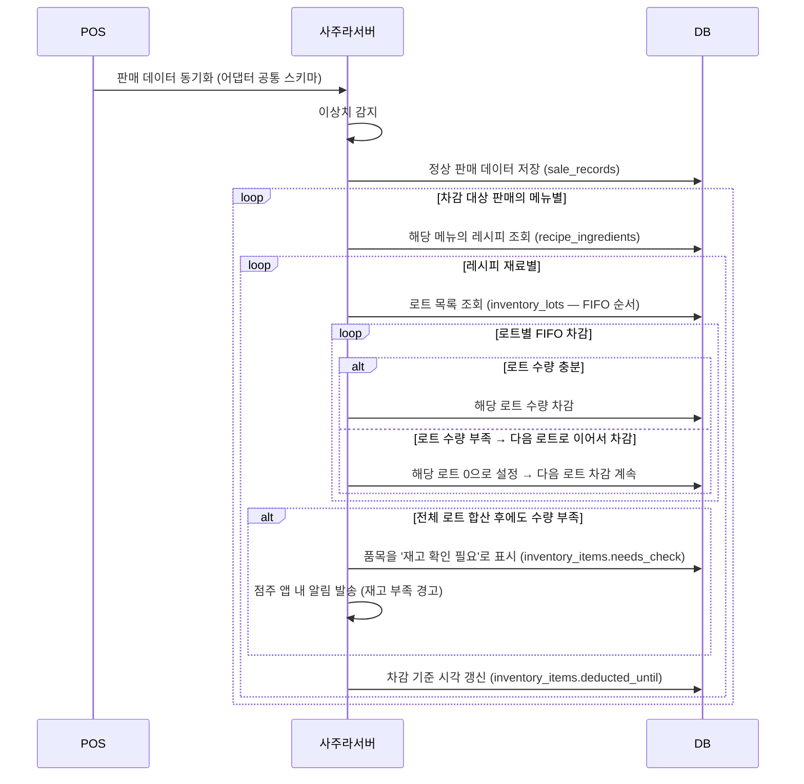
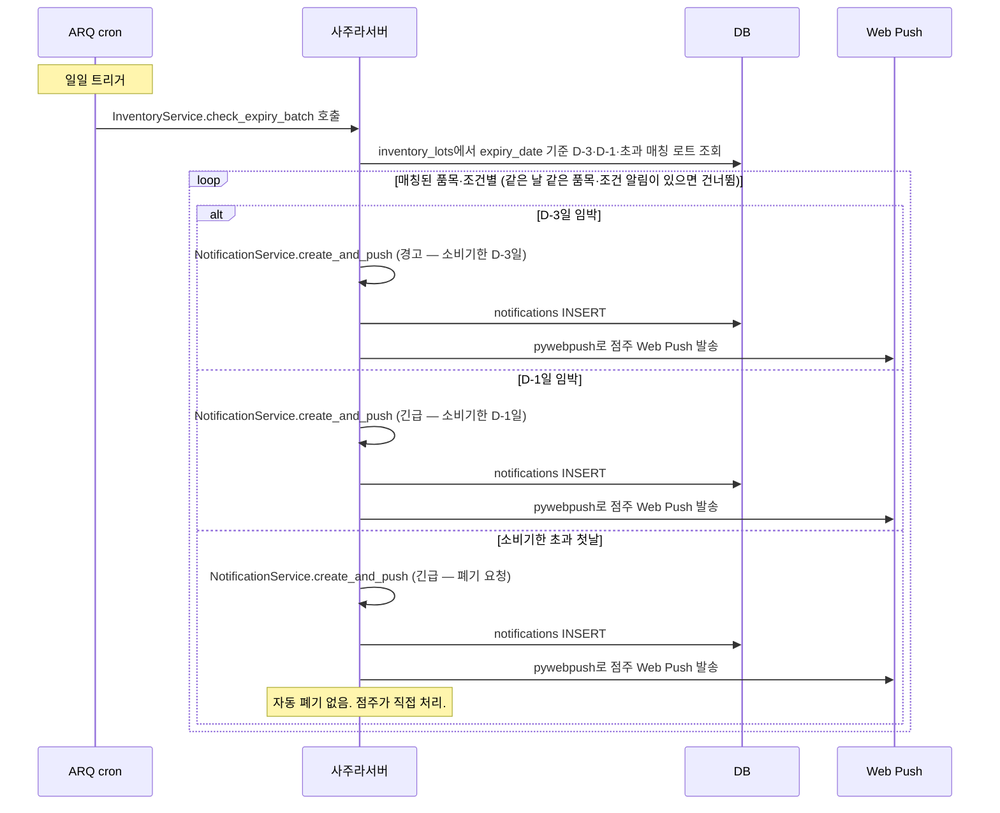
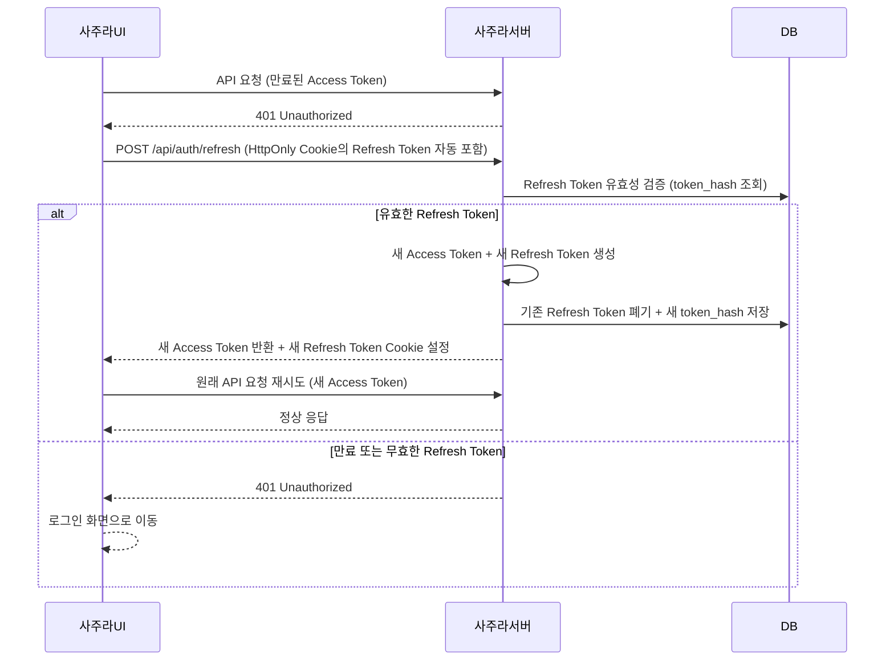
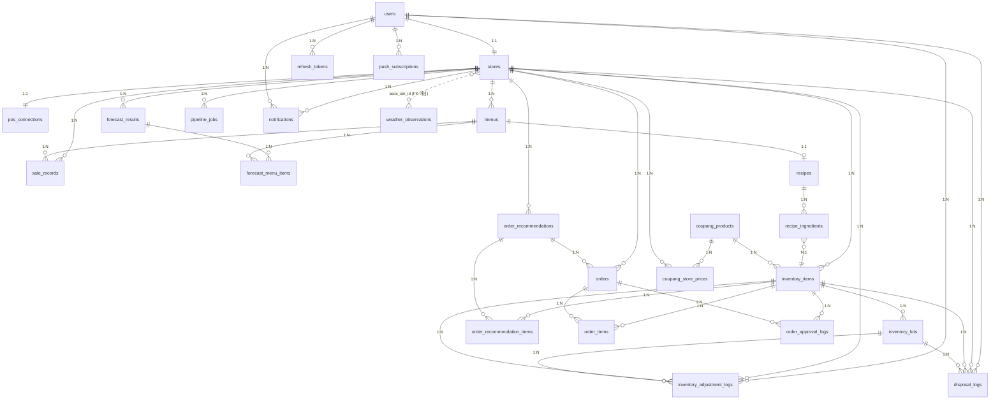

# 구현 설계

## 1. MVP 범위

### 1.1 MVP 목표

- 핵심 흐름(데이터 업로드 → 예측 → 발주 추천 → 점주 승인 → 쿠팡 자동화)을 실제 동작 수준으로 완성한다.
- 1차 검증 업종(주점) 데이터로 모델을 학습하고 예측 정확도를 검증한다.
- 프로토타입과 MVP가 동일한 아키텍처를 공유하여 단계적으로 확장한다.

### 1.2 1차 검증 업종

'주점'

- 보유한 주점 POS 데이터를 기반으로 모델 학습 및 예측을 수행한다.

데이터 소스: 보유 중인 주점 POS 데이터 → CSV 업로드로 적재

### 1.3 MVP 포함 기능

> 기능 상세 기준: `01_basic_design.md` §3

| 기능 | 프로토타입 | MVP 완성 |
|------|----------|---------|
| 소셜 로그인 + 온보딩 (사업자번호 검증, POS 연동 방식 선택) | O | O |
| 메뉴 관리 (CRUD, 레시피, 소프트 삭제) | O | O |
| 재고 관리 (초기 등록, FIFO 자동 차감, 수동 수정, 폐기) | O | O |
| 소비기한 관리 (D-3/D-1 알림) | O | O |
| CSV 업로드 (주점 POS 데이터) | O | O |
| POS API 연동 (토스플레이스·키움페이·OKPOS — 판매 데이터 자동 수집, 연동 관리 API, 실패 시 CSV 모드) | — | O |
| n8n 배치 파이프라인 (수동 트리거) | O | — |
| n8n 배치 파이프라인 (02:00 자동 스케줄) | — | O |
| 수요예측 (배치 결과 조회, 신뢰도 배지, 예측 근거 기본) | O | O |
| 추천발주 (조회, 점주 수정·승인) | O | O |
| 쿠팡 장바구니 자동화 (브라우저 확장) | O | O |
| 기본 대시보드 (매출·예측 시각화) | O | O |
| 앱 내 알림 (푸시 + 인앱) | — | O |
| 판매 데이터 조회 | O | O |

### 1.4 MVP 제외 기능

2단계

- 주간 모델 재학습 배치 — 매주 일요일 n8n이 `pipeline_jobs`(TRAIN)를 만들고 AI Server 재학습 호출
- 모델 재학습 API — `POST /ai/forecast/train`, `GET /ai/forecast/status`의 학습 작업 조회, `GET /ai/health`의 `last_trained_at` 채움
- 모델 고도화 — 초기 모델의 예측 품질 개선
- 외부 변수 확장 — 방문인구(SK 지오비전)·경제지표(한국은행 ECOS)·검색량(네이버 데이터랩)·SNS 노출도·지역 이벤트 피처 추가, SNS 노출도·지역 이벤트는 AI SDK로 수집
- ROI 대시보드 — 폐기율·회전율·예측 정확도 지표 집계
- ROI 지표 API — `GET /api/dashboard/roi`
- Cold-start — 유사 매장 매칭
- 다중 업종 지원 — 카페·치킨집 등 주점 외 업종 확장
- 데이터 내보내기·삭제 — GDPR 대응. 마이페이지에서 `GET /api/data/export`(CSV 다운로드), `DELETE /api/data`(전체 데이터 삭제)
- 테스트 커버리지 80% — BE branch coverage 목표

3단계

- Enterprise 요금제·다중 매장 관리

후속

- 관리자 종합 관리도구 — 사용자·매장 종합 관리

### 1.5 고도화 로드맵

| 단계 | 주요 기능 |
|------|----------|
| 2단계 | 모델 재학습 배치, ROI 대시보드, Cold-start, 다중 업종 지원 |
| 3단계 | 다중 매장 관리, Enterprise 요금제, 경량 스트리밍 파이프라인, 외생변수 고도화 모델 |

### 1.6 데모 시나리오

시나리오: 신규 점주 온보딩 → 당일 발주까지

| Step | 행위 | 확인 포인트 |
|------|------|------------|
| 1. 로그인 및 온보딩 | 소셜 로그인 → 사업자번호 검증 → 매장 정보 입력 → CSV 임시 모드 선택 | 국세청 API 검증 결과, onboarding_completed 전환 |
| 2. 데이터 적재 | 주점 POS 데이터 CSV 업로드 → 메뉴·레시피 등록 → 초기 재고 입력 | 업로드 파싱 성공 건수, 이상치 감지 결과 |
| 3. 배치 실행 | n8n 워크플로우 수동 트리거 → AI Server 예측·추천발주 생성 → DB 저장 | pipeline_jobs 상태 DONE 전환, forecast_results 생성 확인 |
| 4. 수요예측 확인 | 메뉴별 1~3일 예상 수요 조회 → 예측 근거 확인 → 신뢰도 배지 확인 | 예측 근거 표시(`05_ai.md` §8), 신뢰도 낮음 배지 동작 |
| 5. 추천발주 승인 | 품목별 권장 수량·예상 소진 시점 확인 → 수량 수정 → 발주 확정 | 수정 이력 저장 (order_approval_logs), 발주 확정 처리 |
| 6. 쿠팡 자동화 | 사주라 확장이 쿠팡 장바구니에 품목 자동 담기 → 결과 화면 표시 | 성공 품목·실패 품목 분리 표시, 수동 처리 안내 |

### 1.7 성공 기준

#### 기능 완성 기준

데모 시나리오 Step 1~6이 오류 없이 end-to-end로 동작해야 한다.

| 항목 | 기준 |
|------|------|
| 수요예측 결과 표시 | 메뉴별 1~3일 예측값 + 신뢰도 배지 화면 정상 표시 |
| 예측 근거 표시 | top-3 기여 요인 + 자연어 1문장 정상 표시 (`05_ai.md` §8) |
| 추천발주 이력 기록 | 점주 수정·승인 후 `order_approval_logs`에 이력 저장 확인 |
| 쿠팡 자동화 | 성공·부분 실패·전체 실패 분기 모두 화면 정상 처리 |
| n8n 배치 | 수동 트리거 시 `pipeline_jobs` 상태가 DONE으로 전환 |

#### 예측 품질 기준

- 초기 모델은 "신뢰도 낮음" 배지가 붙을 수 있음을 인정하고 시작한다.

#### 성능 기준

> 응답 시간 목표: `01_basic_design.md` §5.3

- 시연 환경에서 최소 1~5개 매장 정상 동작을 확인한다.

### 1.8 데이터 확보 방식

시연 데이터는 팀이 보유한 주점 POS 데이터를 CSV로 적재한다. POS API 연동은 가맹점 자격증명을 확보한 매장에서 쓴다.

| 항목 | 내용 |
|------|------|
| 데이터 소스 | 팀 보유 주점 POS 데이터 (실제 매장 판매 이력) |
| 적재 방식 | CSV 파일 변환 후 `POST /api/sales/upload` 로 업로드 |
| 전처리 | 업로드 시 파싱·이상치 감지 자동 수행, 파싱 실패 건수 화면에 표시 |
| 확보 기간 | 월 단위 walk-forward 5 fold를 구성할 수 있는 분량 (`docs/research/ai/02_preprocessing.md`) — `SHORT_HISTORY` 배지 기준 60 영업일을 넘는다 |
| 한계 | 단일 매장 데이터라 다매장 일반화는 검증되지 않았다. 신뢰도 배지는 데이터 부족(`SHORT_HISTORY`)이 아니라 공휴일·선행일·구간 폭 트리거로 붙는다 (`01_basic_design.md` §3.6.3) |

### 1.9 개발 역할 분담

> 세부 일정: `docs/plan/04_gantt.md`

| 파트 | 담당 업무 | 팀원 |
|------|----------|------|
| Frontend | 화면 설계, React 개발, PWA 기술 적용, 수요예측·재고·발주 UI, 사주라 브라우저 확장 | 정동욱, 이민욱, 임형택 |
| AI Modeling | 데이터 수집·전처리, 모델 학습·평가, 예측 근거 구현(`05_ai.md` §8), n8n AI 파이프라인 연동 | 정동욱, 이민욱, 서창현 |
| Backend | REST API 서버, DB 설계·운영, n8n 배치 파이프라인, 쿠팡 자동 담기 서버 측(상품 선택·결과 기록) | 서창현, 임형택 |

파트 간 공유 책임:
- n8n 파이프라인 설계: Backend 주도, AI Modeling 연동 협의
- 데모 시나리오 검증: 전 파트 참여 (Step 1~6 end-to-end 검증)

---

## 2. 시퀀스

### 2.1 전체 시스템 흐름

```text
[점주 요청 흐름]
1. 사용자 요청
2. Frontend → Backend API 호출
3. Backend → DB 조회 (n8n이 사전 생성·저장한 예측/추천 결과)
4. 결과 존재 → 즉시 반환
5. 결과 없음 → Backend가 AI Server 직접 호출 → 결과 생성 → DB 저장 → 반환

[발주 흐름]
6. 점주가 추천발주안 확인 / 수정 / 확정
7. 발주 내역 DB 저장
8. 사주라 확장 → 점주 브라우저의 쿠팡 장바구니 자동 담기
9. 실제 결제는 쿠팡에서 진행

[배치 흐름 — n8n 주도]
10. 판매 결과, 폐기 데이터, 점주 수정 이력 DB 축적
11. n8n이 매일 예측 배치 트리거 → AI Server 호출 → 결과 DB 저장
```

> 배치 실행 시각·순서: `01_basic_design.md` §3.11

### 2.2 소셜 로그인 및 온보딩 시퀀스

> 인증 방식: `03_be.md` §7.1. API: §3.2·§3.3



### 2.3 수요예측 시퀀스

> n8n이 예측 배치를 주도하고 결과를 DB에 사전 저장한다. Backend는 저장된 결과를 반환하고, 없으면 수동 실행으로 그 매장의 n8n 워크플로우를 실행시킨다.



### 2.4 발주 확정 및 쿠팡 자동화 시퀀스

> 발주 확정과 쿠팡 자동화는 별도 엔드포인트로 분리된다(§3.7).
> 브라우저 조작은 사주라 확장이 점주 브라우저에서 수행한다 — 구조: `04_fe.md` §12.



### 2.5 야간 배치 파이프라인 시퀀스

> 실행 시각·단계 순서·재시도 규칙: `01_basic_design.md` §3.11.1



> 추천발주는 배치에서 만들지 않는다. 점주가 요청할 때 BE가 저장된 예측으로 계산한다(`01_basic_design.md` §3.7.2).
> 점주 알림은 BE `NotificationService.create_and_push`가 일관 처리(인앱 INSERT + Web Push). n8n은 BE API를 트리거할 뿐 직접 알림을 만들지 않는다. 개발팀 Slack 알림만 n8n에서 직접 발송.

### 2.6 재고 자동 차감(FIFO) 시퀀스

> POS 판매 데이터 저장 시 레시피 기반으로 재고를 FIFO로 자동 차감한다. 차감 대상 판매·로트 순서·'재고 확인 필요' 기준은 `01_basic_design.md` §3.3.3.



### 2.7 소비기한 배치 및 알림 시퀀스

> BE ARQ `cron_jobs`가 실행한다. 실행 시각·조건별 처리: `01_basic_design.md` §3.3.6, 알림 정책: `01_basic_design.md` §3.12.



### 2.8 Refresh Token 갱신 시퀀스

> 토큰 정책: `03_be.md` §7.3



---

## 3. API 계약

### 3.1 공통 규약

#### 3.1.1 Base URL

```
/api/
```

버전 관리 없음. Breaking change 시 클라이언트와 서버를 함께 배포한다.

예외: 헬스체크 `GET /health`는 `/api/` 밖에 두고 인증 없이 `{"status": "ok"}`를 반환한다. Docker 컨테이너와 Caddy 헬스체크가 사용한다.

#### 3.1.2 인증 헤더

```
Authorization: Bearer <access_token>
```

> Access Token·Refresh Token 유효기간·저장 위치·Rotation: `03_be.md` §7.3

#### 3.1.3 에러 응답 형식

```json
{
  "error": "ERROR_CODE",
  "message": "사람이 읽을 수 있는 오류 메시지",
  "detail": null,
  "path": "/api/...",
  "timestamp": "2026-05-06T02:00:00Z"
}
```

`detail`은 validation 에러 시 필드별 오류 목록:

```json
"detail": [
  { "field": "business_no", "message": "사업자등록번호 형식이 올바르지 않습니다." }
]
```

> 에러 코드 목록: `03_be.md` §11. 이 문서에는 엔드포인트별 사례만 적는다.

#### 3.1.4 HTTP 상태 코드

| 코드 | 의미 | 사용 예시 |
|------|------|-----------|
| `200` | 성공 (조회/수정) | GET, PUT, PATCH 성공 |
| `201` | 생성 성공 | POST로 리소스 생성 시 |
| `204` | 성공 (body 없음) | DELETE 성공, 로그아웃 등 |
| `400` | 잘못된 요청 | validation 실패, 형식 오류 |
| `401` | 인증 실패 | 토큰 없음/만료 |
| `403` | 권한 없음 | 다른 매장 데이터 접근 시도, 사업자 검증 전·반려 상태의 매장 데이터 접근(`BUSINESS_NOT_VERIFIED`, `03_be.md` §8.1) |
| `404` | 리소스 없음 | 존재하지 않는 ID 조회 |
| `409` | 충돌 | 중복 사업자번호 가입 |
| `422` | 처리 불가 | 비즈니스 로직 오류 (재고 0인데 차감 등) |
| `429` | 요청 과다 | 자동 담기 중복 호출 등 |
| `500` | 서버 오류 | 예상치 못한 서버 에러 |
| `503` | 서비스 불가 | AI Server 다운, POS 연동 불가 |

#### 3.1.5 페이지네이션 / 정렬 / 필터

목록 조회 공통 Query Parameter:

| 파라미터 | 예시 | 설명 |
|----------|------|------|
| `page` | `?page=1` | 페이지 번호 (1부터 시작) |
| `size` | `?size=20` | 페이지당 항목 수 |
| `sort` | `?sort=created_at` | 정렬 기준 필드 |
| `order` | `?order=desc` | 정렬 방향 (asc / desc) |

필터 파라미터는 각 API마다 개별 정의 (예: `?start_date=`, `?end_date=`, `?menu_id=`).

목록 응답 공통 구조:

```json
{
  "items": [...],
  "total": 100,
  "page": 1,
  "size": 20,
  "total_pages": 5
}
```

### 3.2 인증 API

#### Endpoints

| Method | Path | 설명 | 인증 필요 |
|--------|------|------|-----------|
| `POST` | `/api/auth/register` | 회원가입 (email·password·name만, 사업자 검증은 별도 단계) | X |
| `POST` | `/api/auth/login` | 이메일/비밀번호 로그인 | X |
| `GET` | `/api/auth/login/kakao` | 카카오 OAuth 인가 URL 리다이렉트 | X |
| `GET` | `/api/auth/callback/kakao` | 카카오 인가 코드 수신 → Refresh Set-Cookie + FE 진입 URL로 302 redirect | X |
| `GET` | `/api/auth/login/google` | 구글 OAuth 인가 URL 리다이렉트 | X |
| `GET` | `/api/auth/callback/google` | 구글 인가 코드 수신 → Refresh Set-Cookie + FE 진입 URL로 302 redirect | X |
| `POST` | `/api/auth/logout` | 로그아웃 (현 디바이스) | O |
| `POST` | `/api/auth/logout-all` | 강제 로그아웃 — 모든 디바이스 일괄 폐기 | O |
| `POST` | `/api/auth/refresh` | Access Token 재발급 | X (Cookie) |
| `GET` | `/api/auth/me` | 내 정보 조회 | O |
| `PATCH` | `/api/auth/me` | 일반 정보 수정 | O |
| `PATCH` | `/api/auth/password` | 비밀번호 변경 (LOCAL 계정만) | O |
| `DELETE` | `/api/auth/me` | 회원 탈퇴 | O |

#### POST /api/auth/register

```json
// Request
{
  "email": "owner@example.com",
  "password": "string",
  "name": "홍길동"
}

// Response 201
{
  "user_id": "uuid",
  "email": "owner@example.com",
  "name": "홍길동"
}
```

> 회원가입은 email·password·name만 받는다. 사업자등록번호·매장명은 가입 이후 사업자 검증(`POST /api/store/business/verify`)·온보딩(`PATCH /api/store`) 단계에서 입력한다. 소셜·이메일 계정 모두 가입 직후 `business_status=UNVERIFIED` 상태로 시작한다.

#### POST /api/auth/login

```json
// Request
{
  "email": "owner@example.com",
  "password": "string"
}

// Response 200
{
  "access_token": "jwt_string",
  "token_type": "bearer",
  "expires_in": 3600,
  "business_status": "UNVERIFIED",
  "onboarding_completed": true
}
// Refresh Token은 HttpOnly Cookie로 Set-Cookie
```

> FE 진입 분기: `business_status` ∈ {UNVERIFIED, REJECTED} → 사업자 검증 화면 / {PENDING, VERIFIED} && `onboarding_completed=false` → 온보딩 / 둘 다 충족 → 메인.

#### GET /api/auth/login/kakao

```
// Response: 302 Redirect → 카카오 OAuth 인가 페이지
```

#### GET /api/auth/callback/kakao

```
// Query: ?code=인가코드&state=csrf_state
// Response: 302 Redirect → FE 진입 URL (예: https://<sub>.iptime.org/)
// + Set-Cookie: refresh_token=...; HttpOnly; Secure; SameSite=Lax
// (Access Token은 응답 본문·URL에 노출 안 함 — FE가 첫 진입 시 POST /api/auth/refresh로 동기)
```

> 흐름: BE가 OAuth 콜백 수신 → Authlib으로 인가 코드 교환 → 사용자 정보 조회·JWT 발급 → Refresh를 HttpOnly Cookie로 설정 후 FE root("/")로 302 redirect. FE는 첫 진입 시 메모리 Access Token 부재를 감지하여 `POST /api/auth/refresh` 1회 호출로 Access Token을 동기한다.

#### GET /api/auth/login/google

```
// Response: 302 Redirect → 구글 OAuth 인가 페이지
```

#### GET /api/auth/callback/google

```
// Query: ?code=인가코드&state=csrf_state
// Response: 302 Redirect → FE 진입 URL (예: https://<sub>.iptime.org/)
// + Set-Cookie: refresh_token=...; HttpOnly; Secure; SameSite=Lax
// (동작 상세는 GET /api/auth/callback/kakao 동일)
```

#### POST /api/auth/logout

```
// Request: Header만 (Authorization: Bearer <token>)
// Response: 204 No Content
```

#### POST /api/auth/logout-all

> 모든 디바이스의 활성 Refresh Token을 일괄 폐기한다. 정책: `03_be.md` §7.3

```
// Request: Header만 (Authorization: Bearer <token>)
// Response: 204 No Content
```

#### POST /api/auth/refresh

```json
// Request: Cookie의 Refresh Token 자동 전송 (body 없음)

// Response 200
{
  "access_token": "new_jwt_string",
  "token_type": "bearer",
  "expires_in": 3600
}
// 새 Refresh Token Set-Cookie (Rotation)
```

#### GET /api/auth/me

```json
// Response 200
{
  "user_id": "uuid",
  "email": "owner@example.com",
  "name": "홍길동",
  "auth_provider": "LOCAL",
  "store_name": "길동 카페",
  "business_no": "123-45-67890",
  "business_status": "VERIFIED",
  "role": "OWNER",
  "onboarding_completed": true,
  "created_at": "2026-01-01T00:00:00Z"
}
```

> `store_name`·`business_no`는 사업자 검증·온보딩 전이면 `null`. `business_status`가 `UNVERIFIED`·`REJECTED`면 FE는 사업자 검증 화면으로 강제 이동한다. `role`이 `ADMIN`이면 `/admin` 심사 화면 접근 가능.

#### PATCH /api/auth/me

```json
// Request (변경할 필드만)
{
  "name": "홍길동2",
  "store_name": "새 카페"
}
// Response 200: GET /api/auth/me 와 동일 구조
```

#### PATCH /api/auth/password

```json
// Request
{
  "current_password": "string",
  "new_password": "string"
}
// Response: 204 No Content
```

#### DELETE /api/auth/me

> 계정을 탈퇴 유예 상태로 바꾸고 모든 Refresh Token을 폐기한다. 30일 뒤 배치가 파기한다 (`01_basic_design.md` §5.2.1).

```json
// Request
{
  "password": "string"   // 이메일 계정만 확인. 소셜 계정은 빈 문자열
}
// Response: 204 No Content
// 401 AUTH_INVALID_CREDENTIALS: 비밀번호 불일치
```

탈퇴 유예 중인 계정의 다른 경로 응답:

| 경로 | 응답 |
|---|---|
| `POST /api/auth/login` | 403 `AUTH_ACCOUNT_WITHDRAWN` |
| `POST /api/auth/register` (같은 이메일) | 409 `AUTH_ACCOUNT_WITHDRAWN` |
| `GET /api/auth/callback/{provider}` | 302 → FE `/login?error=withdrawn` |
| `POST /api/auth/refresh` | 401 `AUTH_REFRESH_TOKEN_INVALID` (탈퇴 시 폐기됨) |

### 3.3 매장/POS API

> `pos_type`은 `TOSSPLACE` / `KIWOOM` / `OKPOS` 중 하나다 (`01_basic_design.md` §3.4.3). 자격증명 필드는 회사별 조사 후 확정한다.

#### Endpoints

| Method | Path | 설명 |
|--------|------|------|
| `POST` | `/api/store/business/verify` | 사업자 검증 — NTS 조회 + 등록증 업로드 → PENDING (multipart) |
| `GET` | `/api/store` | 내 매장 정보 조회 |
| `PATCH` | `/api/store` | 매장 정보 수정 |
| `POST` | `/api/store/onboarding/complete` | 온보딩 완료 처리 |
| `GET` | `/api/admin/verifications` | (ADMIN) 사업자 검증 심사 큐 — PENDING 목록 |
| `GET` | `/api/admin/verifications/{store_id}/cert` | (ADMIN) 업로드된 사업자등록증 파일 조회 |
| `POST` | `/api/admin/verifications/{store_id}/approve` | (ADMIN) 승인 → VERIFIED |
| `POST` | `/api/admin/verifications/{store_id}/reject` | (ADMIN) 반려 → REJECTED (+사유) |
| `GET` | `/api/store/pos` | POS 연동 정보 조회 |
| `POST` | `/api/store/pos` | POS 연동 등록 |
| `PATCH` | `/api/store/pos` | POS 연동 정보 수정 |
| `DELETE` | `/api/store/pos` | POS 연동 해제 |
| `POST` | `/api/store/pos/sync` | POS 데이터 수동 동기화 요청 |
| `GET` | `/api/store/pos/status` | POS 연동 상태 조회 (`CSV_MODE`·`CONNECTED`·`ERROR`·`DISCONNECTED`) |

> 1계정 1매장 구조라 `/api/store/{id}` 대신 `/api/store`를 쓴다.

#### POST /api/store/business/verify

```
// Request (인증 필요) — multipart/form-data
//   business_no: "123-45-67890"
//   cert:        <사업자등록증 파일 (image/* 또는 application/pdf)>

// Response 200 — NTS 통과 + 등록증 저장 → 심사 대기
{
  "business_status": "PENDING",   // 마스터 코드면 "VERIFIED"
  "business_no": "123-45-67890"
}

// 실패 — 형식 오류·미등록: 400 AUTH_BUSINESS_NO_INVALID
// 실패 — 휴업/폐업: 422 AUTH_BUSINESS_NO_NOT_ACTIVE
// 실패 — 국세청 서비스 장애: 503 SERVICE_UNAVAILABLE
// 실패 — 파일 형식·용량 위반: 400 VALIDATION_ERROR
```

> 온보딩 진입 전 게이트. ① 국세청 조회로 계속사업자 여부 확인 → ② 통과 시 등록증 파일을 서버 볼륨에 저장(경로만 DB)하고 `business_status=PENDING`. PENDING부터 온보딩 진입을 허용한다. 실패 시 계정·상태를 유지하고 사유만 반환한다(삭제 없음). 입력 `business_no`가 마스터 코드(`NTS_MASTER_BYPASS_CODE`)와 일치하면 NTS 호출·파일 없이 곧바로 `VERIFIED`(시연용, `03_be.md` §7.4). 소셜·이메일 공통. 검증 어댑터: `nts.assert_business_active`, 승인 루프: 관리자 심사 API(아래).

#### 관리자 심사 API (role=ADMIN 전용)

> `users.role=ADMIN`만 접근. 그 외 403 FORBIDDEN. 사업자등록증 파일 조회도 ADMIN 가드 하에서만 한다 (`03_be.md` §10.2).

```json
// GET /api/admin/verifications?status=pending
// Response 200
{
  "items": [
    {
      "store_id": "uuid", "user_email": "owner@example.com",
      "business_no": "123-45-67890", "business_status": "PENDING",
      "cert_url": "/api/admin/verifications/uuid/cert", "submitted_at": "2026-01-01T00:00:00Z"
    }
  ],
  "total": 1, "page": 1, "size": 20, "total_pages": 1
}

// GET /api/admin/verifications/{store_id}/cert  → 등록증 파일 바이너리(이미지/PDF)

// POST /api/admin/verifications/{store_id}/approve
// Response 200: { "store_id": "uuid", "business_status": "VERIFIED" }

// POST /api/admin/verifications/{store_id}/reject
// Request: { "reason": "등록증과 입력 사업자번호 불일치" }
// Response 200: { "store_id": "uuid", "business_status": "REJECTED", "reason": "..." }
```

#### GET /api/store

```json
// Response 200
{
  "store_id": "uuid",
  "store_name": "길동 카페",
  "business_no": "123-45-67890",
  "business_type": "카페",
  "store_size": "SMALL",
  "operation_type": "HALL",
  "address": "서울시 강남구 ...",
  "phone": "02-1234-5678",
  "business_status": "VERIFIED",
  "business_reject_reason": null,
  "onboarding_completed": true,
  "created_at": "2026-01-01T00:00:00Z"
}
```

> 사업자 검증 전이면 `business_no`·`store_name` 등은 `null`, `business_status="UNVERIFIED"`. `business_reject_reason`은 `business_status="REJECTED"`일 때만 사유 문자열, 그 외 `null` — FE가 `/verify-business`에서 반려 사유를 표시하는 데 사용한다.

#### PATCH /api/store

```json
// Request (변경할 필드만)
{
  "store_name": "새 카페",
  "business_type": "카페",
  "store_size": "SMALL",
  "operation_type": "HALL",
  "address": "서울시 서초구 ...",
  "phone": "02-9999-8888"
}
// Response 200: GET /api/store 와 동일 구조
```

#### POST /api/store/onboarding/complete

```json
// Request: body 없음
// Response 200
{
  "onboarding_completed": true,
  "store_id": "uuid"
}
```

> 온보딩 Step 4(초기 재고/메뉴 입력) 완료 후 Frontend가 호출한다. `stores.onboarding_completed`를 `true`로 업데이트하고, 이후 로그인 응답에 `onboarding_completed: true`가 반환된다. 이미 완료된 상태에서 재호출 시 동일 응답을 반환(멱등).

#### GET /api/store/pos

```json
// Response 200
{
  "pos_type": "TOSSPLACE",
  "api_key": "tp*******34",   // 앞 2자·뒤 2자만 노출
  "store_code": "12345",
  "connected_at": "2026-01-01T00:00:00Z"
}
```

#### POST /api/store/pos

```json
// Request
{
  "pos_type": "TOSSPLACE",
  "api_key": "string",   // 1~150자. 암호화 저장 (03_be.md §10.1)
  "store_code": "12345"
}
// Response 201: GET /api/store/pos 와 동일 구조
```

#### PATCH /api/store/pos

```json
// Request (변경할 필드만)
{
  "api_key": "new_string"
}
// Response 200: GET /api/store/pos 와 동일 구조
```

#### DELETE /api/store/pos

```
// Response: 204 No Content
```

#### POST /api/store/pos/sync

```json
// Request: body 없음
// Response 200
{
  "synced_at": "2026-05-06T02:00:00Z",
  "records_synced": 142
}
```

#### GET /api/store/pos/status

```json
// Response 200
{
  "status": "CONNECTED",  // CONNECTED | ERROR | CSV_MODE | DISCONNECTED
  "last_synced_at": "2026-05-06T01:00:00Z",
  "error_message": null
}
```

### 3.4 메뉴/레시피 API

#### Endpoints

| Method | Path | 설명 |
|--------|------|------|
| `GET` | `/api/menus` | 메뉴 목록 조회 |
| `POST` | `/api/menus` | 메뉴 등록 |
| `POST` | `/api/menus/bulk` | 메뉴 일괄 등록 (POS 연동 시) |
| `GET` | `/api/menus/{menu_id}` | 메뉴 상세 조회 |
| `PATCH` | `/api/menus/{menu_id}` | 메뉴 수정 |
| `DELETE` | `/api/menus/{menu_id}` | 메뉴 삭제 |
| `GET` | `/api/menus/{menu_id}/recipe` | 레시피 조회 |
| `PUT` | `/api/menus/{menu_id}/recipe` | 레시피 등록/전체 수정 |
| `DELETE` | `/api/menus/{menu_id}/recipe` | 레시피 삭제 |

#### GET /api/menus

```json
// Query: ?page=1&size=20&sort=name&order=asc&category=음료
// 기본적으로 is_deleted=false 메뉴만 반환
// Response 200
{
  "items": [
    {
      "menu_id": "uuid",
      "name": "아메리카노",
      "category": "음료",
      "price": 4500,
      "is_active": true,
      "use_inventory_deduction": true,
      "has_recipe": true,             // 재료 1개 이상의 레시피 보유
      "is_deleted": false
    }
  ],
  "total": 30,
  "page": 1,
  "size": 20,
  "total_pages": 2
}
```

#### POST /api/menus

```json
// Request
{
  "name": "아메리카노",
  "category": "음료",
  "price": 4500,
  "is_active": true,
  "use_inventory_deduction": false   // 기본 false. 등록 시점엔 레시피가 없어 true면 422 MENU_RECIPE_REQUIRED
}

// Response 201
{
  "menu_id": "uuid",
  "name": "아메리카노",
  "category": "음료",
  "price": 4500,
  "is_active": true,
  "use_inventory_deduction": false,
  "has_recipe": false,
  "is_deleted": false,
  "deleted_at": null,
  "created_at": "2026-05-06T00:00:00Z"
}
```

#### POST /api/menus/bulk

```json
// Request
{
  "menus": [
    {
      "name": "아메리카노",
      "category": "음료",
      "price": 4500,
      "is_active": true,
      "use_inventory_deduction": false  // POST /api/menus와 같은 규칙. true인 항목이 있으면 422 MENU_RECIPE_REQUIRED
    }
  ]
}

// Response 201
{
  "created": 12,
  "skipped": 2,
  "skipped_names": ["라떼", "에스프레소"]
}
// skipped: 동일 이름 메뉴가 이미 존재하는 경우
// 메뉴명 중복 검증은 동일 매장의 is_deleted=false 메뉴만 대상으로 수행
```

#### GET /api/menus/{menu_id}

```json
// Response 200
{
  "menu_id": "uuid",
  "name": "아메리카노",
  "category": "음료",
  "price": 4500,
  "is_active": true,
  "use_inventory_deduction": true,
  "has_recipe": true,
  "is_deleted": false,
  "deleted_at": null,
  "created_at": "2026-05-06T00:00:00Z",
  "updated_at": "2026-05-06T00:00:00Z"
}
```

#### PATCH /api/menus/{menu_id}

```json
// Request (변경할 필드만)
{
  "price": 5000,
  "is_active": false,
  "use_inventory_deduction": false
}
// Response 200: GET /api/menus/{menu_id} 와 동일 구조
// 422 MENU_RECIPE_REQUIRED: 레시피 없는 메뉴의 use_inventory_deduction을 true로 변경
```

#### DELETE /api/menus/{menu_id}

```
// Response: 204 No Content
// 실제 DB 삭제가 아니라 is_deleted=true, deleted_at=현재시각으로 소프트 삭제
// 삭제된 메뉴의 과거 판매 데이터는 menu_id 참조로 유지
```

#### GET /api/menus/{menu_id}/recipe

```json
// Response 200
{
  "menu_id": "uuid",
  "ingredients": [
    {
      "item_id": "uuid",
      "item_name": "원두",
      "quantity": 18.0,
      "unit": "g"
    },
    {
      "item_id": "uuid",
      "item_name": "물",
      "quantity": 200.0,
      "unit": "ml"
    }
  ],
  "updated_at": "2026-05-06T00:00:00Z"
}
```

#### PUT /api/menus/{menu_id}/recipe

```json
// Request (전체 재작성)
{
  "ingredients": [
    {
      "item_id": "uuid",
      "quantity": 18.0,
      "unit": "g"
    }
  ]
}
// Response 200: GET /api/menus/{menu_id}/recipe 와 동일 구조
// 400 VALIDATION_ERROR: 같은 매장 재고 목록에 없는 item_id 포함
// 422 MENU_RECIPE_REQUIRED: 재고 차감 ON 메뉴에 빈 ingredients
```

#### DELETE /api/menus/{menu_id}/recipe

```
// Response: 204 No Content
// 422 MENU_RECIPE_REQUIRED: 재고 차감 ON 메뉴
```

### 3.5 재고 API

#### Endpoints

| Method | Path | 설명 |
|--------|------|------|
| `GET` | `/api/inventory` | 재고 목록 조회 |
| `POST` | `/api/inventory` | 재고 품목 등록 |
| `GET` | `/api/inventory/{item_id}` | 재고 품목 상세 조회 |
| `PATCH` | `/api/inventory/{item_id}` | 재고 품목 정보 수정 |
| `DELETE` | `/api/inventory/{item_id}` | 재고 품목 삭제 |
| `POST` | `/api/inventory/{item_id}/lots` | 입고 등록 (로트 추가) |
| `GET` | `/api/inventory/{item_id}/lots` | 로트 목록 조회 |
| `PATCH` | `/api/inventory/{item_id}/lots/{lot_id}` | 로트 수량/소비기한 수정 |
| `POST` | `/api/inventory/{item_id}/dispose` | 폐기 처리 |
| `GET` | `/api/prices/ingredients` | 주요 식자재 시세 조회 (KAMIS) |

#### GET /api/inventory

```json
// 매장의 전체 품목을 반환한다. 페이지네이션 없음(§3.1.5 예외), 순서 보장 없음
// 정렬·경고 배지 판정은 FE가 한다 (04_fe.md §4.6)
// Response 200
{
  "items": [ /* GET /api/inventory/{item_id} 와 같은 구조 */ ]
}
```

| 필드 | 값 |
|---|---|
| `total_quantity` | 품목 로트의 `remaining_quantity` 합계 |
| `nearest_expiry_date` | 잔여 수량이 남은 로트 중 가장 이른 소비기한. 없으면 null |
| `needs_check` | 재고 확인 필요 (`01_basic_design.md` §3.3.3) |

#### POST /api/inventory

> `quantity`가 0보다 크면 첫 로트를 생성한다 (`received_at` = 등록일). 이때 `purchase_price`는 필수다.

```json
// Request
{
  "name": "원두",
  "unit": "g",
  "quantity": 2000.0,          // 필수, 0 이상
  "expiry_date": "2026-08-06", // 선택
  "purchase_price": 11200,     // quantity > 0이면 필수. 등록 수량 전체의 구매 금액(원)
  "low_stock_threshold": 500.0,
  "lead_time_days": 2,
  "safety_stock": 1000.0
}

// Response 201: GET /api/inventory/{item_id} 와 동일 구조
```

#### GET /api/inventory/{item_id}

> `coupang_product`는 재료에 연결된 공용 쿠팡 상품(§4.3.12)이다. 연결이 없으면 `null`. 단가 계산: `01_basic_design.md` §3.3.1.

```json
// Response 200
{
  "item_id": "uuid",
  "name": "원두",
  "unit": "g",
  "low_stock_threshold": 500.0,
  "lead_time_days": 2,
  "safety_stock": 1000.0,
  "total_quantity": 2000.0,
  "nearest_expiry_date": "2026-08-06",
  "needs_check": false,
  "coupang_product": {
    "item_id": "10000000001",
    "product_id": "1000001",
    "product_name": "○○ 원두",
    "option_name": "1kg, 1개",     // 없으면 null
    "sale_price": 28000,           // 판매가(원). 비었으면 null
    "content_quantity": 1000.0,    // 상품 1개 용량(g·ml·개). 모르면 null
    "content_unit": "g",
    "unit_price": 28.0,            // 공용 단가(용량 단위 1당 원). 대조를 통과하지 못했으면 null
    "updated_at": "2026-05-06T10:05:00Z"
  },
  "unit_price": 28.0,            // 재료 단위당 원. 미설정이면 null
  "created_at": "2026-05-06T00:00:00Z",
  "updated_at": "2026-05-06T00:00:00Z"
}
```

#### PATCH /api/inventory/{item_id}

```json
// Request (변경할 필드만)
{
  "low_stock_threshold": 800.0,
  "lead_time_days": 3,
  "safety_stock": 1200.0
}
// Response 200: GET /api/inventory/{item_id} 와 동일 구조
```

#### DELETE /api/inventory/{item_id}

```
// Response: 204 No Content
// 409 INVENTORY_ITEM_IN_USE: 레시피에서 사용 중이거나 발주 내역(`order_items`·`order_approval_logs`)에 포함된 재료
```

> 추천발주 스냅샷(`order_recommendation_items`)의 해당 품목 행과 로트·재고 조정 이력·폐기 이력은 함께 삭제한다.

#### POST /api/inventory/{item_id}/lots

> 품목의 '재고 확인 필요'를 해제한다 (`01_basic_design.md` §3.3.3).

```json
// Request
{
  "quantity": 5000.0,
  "received_at": "2026-05-06",
  "expiry_date": "2026-08-06",  // 선택
  "purchase_price": 28000       // 입고 수량 전체의 구매 금액(원)
}

// Response 201
{
  "lot_id": "uuid",
  "item_id": "uuid",
  "quantity": 5000.0,
  "remaining_quantity": 5000.0,
  "received_at": "2026-05-06",
  "expiry_date": "2026-08-06",
  "purchase_price": 28000
}
```

#### GET /api/inventory/{item_id}/lots

```json
// Response 200
{
  "item_id": "uuid",
  "item_name": "원두",
  "lots": [
    {
      "lot_id": "uuid",
      "quantity": 5000.0,
      "remaining_quantity": 3000.0,
      "received_at": "2026-05-06",
      "expiry_date": "2026-08-06",
      "purchase_price": 28000
    }
  ],
  "pending_orders": [                // 이 재료의 '입고 대기' 발주 품목, approved_at 오름차순 (01_basic_design.md §3.7.5)
    {
      "order_item_id": "uuid",
      "order_id": "uuid",
      "approved_at": "2026-05-06T10:00:00Z",
      "final_quantity": 3000.0,
      "subtotal": 84000              // 확정 시 단가 미설정이면 null
    }
  ]
}
```

#### PATCH /api/inventory/{item_id}/lots/{lot_id}

> `reason`이 `STOCKTAKE`이면 품목의 '재고 확인 필요'를 해제한다 (`01_basic_design.md` §3.3.3).

```json
// Request (변경할 필드만, reason 필수)
{
  "remaining_quantity": 2800.0,
  "expiry_date": "2026-08-10",
  "reason": "STOCKTAKE",
  "memo": "월말 실사 조정"
}

// Response 200
{
  "adjustment_id": "uuid",
  "lot_id": "uuid",
  "item_id": "uuid",
  "before_quantity": 3000.0,
  "after_quantity": 2800.0,
  "delta_quantity": -200.0,
  "before_expiry_date": "2026-08-06",
  "after_expiry_date": "2026-08-10",
  "reason": "STOCKTAKE",
  "memo": "월말 실사 조정",
  "adjusted_at": "2026-05-06T10:00:00Z"
}
```

`reason` 값:

| 값 | 설명 |
|----|------|
| `STOCKTAKE` | 실사 조정 |
| `EXPIRY_CORRECTION` | 소비기한 정정 |
| `OTHER` | 기타 |

> 신규 납품 입고는 기존 로트 수정이 아니라 `POST /api/inventory/{item_id}/lots`로 새 로트를 생성한다.

#### POST /api/inventory/{item_id}/dispose

```json
// Request
{
  "lot_id": "uuid",
  "quantity": 500.0,
  "reason": "소비기한 만료"
}

// Response 200
{
  "disposed_quantity": 500.0,
  "remaining_quantity": 2500.0,  // 해당 로트의 잔여 수량
  "disposed_at": "2026-05-06T10:00:00Z"
}
// 404 INVENTORY_LOT_NOT_FOUND: 품목에 속하지 않는 로트
// 422 INVENTORY_DISPOSE_EXCEEDS: 폐기 수량이 로트 잔여 수량 초과
```

#### GET /api/prices/ingredients

> 주요 식자재 시세 참고 경로다 (`01_basic_design.md` §3.3.1).
> 출처는 KAMIS 농산물유통정보 오픈API `dailySalesList`(일별 주요 농축산물 소매가격).
> 매장 재고 품목이 아니라 주요 식자재 고정 목록을 반환한다 — `inventory_items`와 연결되지 않는다.
> API 키 미설정 시 샘플 데이터를 반환한다(시연·로컬용 stub 모드).

```json
// Response 200
[
  {
    "item_name": "양파",
    "price": 1980,
    "unit": "1kg",
    "direction": "DOWN",          // UP | DOWN | SAME (전일 대비)
    "change_percent": -3.2,
    "source": "KAMIS"
  }
]
```

### 3.6 판매 API

#### Endpoints

| Method | Path | 설명 |
|--------|------|------|
| `GET` | `/api/sales` | 판매 내역 목록 조회 (기간 합계 포함) |
| `GET` | `/api/sales/summary` | 판매 요약 (누계·이번 달·오늘) |
| `GET` | `/api/sales/trends` | 메뉴별/기간별 판매 추세 |
| `GET` | `/api/sales/top-menus` | 판매 수량 상위 메뉴 |
| `POST` | `/api/sales/upload` | CSV 파일 업로드 (POS 수동 연동 모드) |

#### GET /api/sales

```json
// Query: ?start_date=2026-01-01&end_date=2026-01-31&menu_id=uuid&page=1&size=20&order=desc
// start_date·end_date: 필수, 양 끝 포함. start_date > end_date이거나 366일을 넘으면 400 VALIDATION_ERROR
// menu_id: 선택. 없거나 다른 매장 메뉴면 404 NOT_FOUND
// 정렬: sold_at 고정. order asc | desc (기본 desc)
// size: 기본 20, 최대 100
// sold_at: 매장 현지 시각, 시간대 표기 없음
// total: 조건에 맞는 판매 기록 수(총 판매 건수), total_revenue: 조건에 맞는 매출 합계
// Response 200
{
  "items": [
    {
      "sale_id": "uuid",
      "menu_id": "uuid",
      "menu_name": "아메리카노",
      "quantity": 3,
      "total_price": 13500,
      "sold_at": "2026-01-15T14:30:00"
    }
  ],
  "total": 540,
  "total_revenue": 2430000,
  "page": 1,
  "size": 20,
  "total_pages": 27
}
```

#### GET /api/sales/summary

```json
// Response 200
// 이번 달·오늘은 매장의 마지막 판매 시각(last_sale_at)이 속한 달·날짜 기준. 판매가 없으면 서버 현재 시각 기준
{
  "total_revenue": 45000000,
  "total_sales_count": 12000,
  "this_month_revenue": 4500000,
  "this_month_sales_count": 1200,
  "today_revenue": 320000,
  "today_sales_count": 85,
  "last_sale_at": "2026-01-31T21:10:00"  // 판매가 없으면 null
}
```

#### GET /api/sales/trends

```json
// Query: ?start_date=2026-01-01&end_date=2026-01-31&group_by=day&menu_id=uuid
// start_date·end_date: 필수, 양 끝 포함. start_date > end_date면 400 VALIDATION_ERROR
// group_by: day | week | month (기본 day)
//   week — start_date부터 7일씩 묶는다 (달력 주 아님)
//   month — 달력 월
// menu_id: 생략하면 매장 전체 합계. 이때 응답의 menu_id·menu_name은 null. 없거나 다른 매장 메뉴면 404 NOT_FOUND
// data: 판매가 없는 구간도 quantity 0·revenue 0으로 채운 연속 값. date는 구간 시작일(month는 그 달 1일)
// Response 200
{
  "menu_id": "uuid",
  "menu_name": "아메리카노",
  "group_by": "day",
  "data": [
    {
      "date": "2026-01-01",
      "quantity": 45,
      "revenue": 202500
    },
    {
      "date": "2026-01-02",
      "quantity": 38,
      "revenue": 171000
    }
  ]
}
```

#### GET /api/sales/top-menus

```json
// Query: ?start_date=2026-01-15&end_date=2026-01-15&limit=5
// start_date·end_date: 선택, 둘 다 주거나 둘 다 생략. 생략하면 전체 판매 기간 누계. start_date > end_date면 400 VALIDATION_ERROR
// limit: 기본 5, 최대 100
// 판매 수량 내림차순
// Response 200
[
  {
    "menu_name": "아메리카노",
    "quantity": 430,
    "revenue": 1935000
  }
]
```

#### POST /api/sales/upload

```
// Request: multipart/form-data
// - file: CSV 파일
// - date_column: "날짜"   (CSV 내 컬럼명 매핑)
// - menu_column: "메뉴명"
// - quantity_column: "수량"
// - price_column: "금액"
// - external_sale_id_column: "영수증번호" (선택)
// - auto_create_menus: "true" (선택, 기본 false) — CSV에 있는 미등록 메뉴명을
//   매장 메뉴에 즉시 추가(카테고리="자동등록", 단가=price/quantity,
//   use_inventory_deduction=false). 그 행은 imported로 처리됨.
// external_sale_id가 없으면 NULL로 저장하며, 이 경우 원본 ID 기반 중복 방지는 적용되지 않음

// Response 201
{
  "imported": 320,
  "skipped": 5,
  "skipped_reasons": [
    "3행: 메뉴명 없음",
    "17행: 금액 형식 오류",
    "매장 메뉴와 매핑 실패: 페페로니피자 (12행), 로제파스타 (7행)",
    "이미 저장된 영수증번호와 중복: 3건"
  ],
  "anomaly_count": 0,
  "auto_created_menus": 0,
  "inventory_deduction": {
    "deducted_sales": 300,     // 재고 차감에 반영된 판매 행 수
    "needs_check_items": [     // 이번 업로드로 새로 '재고 확인 필요'가 된 재료
      { "item_id": "uuid", "name": "원두" }
    ]
  }
}
```

> 저장된 판매는 `01_basic_design.md` §3.3.3 기준으로 재고를 차감한다.

> 그룹화 정책: `매장 메뉴와 매핑 실패`·`같은 파일 안에서 영수증번호 중복`·`이미 저장된 영수증번호와 중복`은 행 단위가 아닌 메뉴·ID·총건수 그룹으로 반환한다. adapter 변환 실패(메뉴명 없음/형식 오류 등)는 `{행번호}행: {사유}` 형식.

### 3.7 수요예측 / 추천발주 / 발주 API

#### Endpoints

| Method | Path | 설명 |
|--------|------|------|
| `GET` | `/api/forecast` | 수요예측 결과 조회 (매장 일 매출 D+1~D+3) |
| `POST` | `/api/forecast/run` | 수요예측 수동 실행 (저장된 예측이 없을 때) |
| `GET` | `/api/orders/recommend` | 추천발주 목록 조회 |
| `POST` | `/api/orders/approve` | 발주 확정 |
| `GET` | `/api/orders` | 발주 내역 목록 조회 |
| `GET` | `/api/orders/{order_id}` | 발주 내역 상세 조회 |
| `POST` | `/api/orders/items/{order_item_id}/receive` | 발주 품목 입고 처리 (로트 생성) |
| `POST` | `/api/orders/items/{order_item_id}/skip` | 발주 품목 입고 안 함 |
| `POST` | `/api/orders/{order_id}/automate/start` | 쿠팡 자동 담기 시작 |
| `POST` | `/api/orders/{order_id}/automate/step` | 담기 에이전트 한 걸음 |
| `POST` | `/api/orders/{order_id}/automate/finish` | 쿠팡 자동 담기 마침 — 발주 상태 갱신 |
| `GET` | `/api/orders/{order_id}/approval-log` | 발주 수정 이력 조회 |

#### GET /api/forecast

> n8n이 저장한 §3.8 `POST /ai/forecast/predict` 결과(`05_ai.md` §2·§3)를 반환한다. BE는 AI Server를 호출하지 않는다.
> 예측 대상은 메뉴별 수량이 아니라 매장 일 매출이며, 대상일은 판매 이력 마지막 영업일 기준 D+1~D+3이다(선행일별 신뢰도 차등 — `05_ai.md` §3.3).
> n8n 야간 배치가 사전 생성해 `forecast_results`·`forecast_menu_items`에 저장한 결과를 반환한다 (`05_ai.md` §7.2).
> 저장된 결과가 없으면 404이고, 점주는 `POST /api/forecast/run`으로 수동 실행한다.

```json
// Query: ?target_date=2026-07-28 (선택 — 생략 시 저장된 D+1~D+3 전체)
// Response 200
{
  "predictions": [
    {
      "target_date": "2026-07-28",
      "horizon_days": 1,
      "predicted_sales": 850000,
      "interval_p10": 520000,          // 80% 예측 구간 (LightGBM quantile)
      "interval_p90": 1310000,
      "is_low_confidence": false,
      "low_confidence_reason": null,   // SHORT_HISTORY | MISSING_FEATURES | SPECIAL_DAY | LONG_HORIZON | WIDE_INTERVAL | DRIFT (01_basic_design.md §3.6.3)
      "explanation": {                 // 05_ai.md §8 — SHAP 합 = 편차, rule-based 문장(LLM 미사용)
        "baseline": "직전 7영업일 평균",
        "deviation_vs_baseline": 0.12,
        "top_factors": [
          { "feature": "dow_3", "label": "목요일 효과", "pct": 0.18 }
        ],
        "sentence": "07월 28일(화)은 평소보다 약 12% 높을 것으로 예상됩니다 — 주요 요인: ..."
      },
      "menu_forecast": [
        { "menu_id": "uuid", "menu_name": "아메리카노", "expected_quantity": 12.5 }
      ]
    }
  ]
}
// 404 FORECAST_NOT_FOUND: 저장된 예측 없음 (POST /api/forecast/run 안내)
```

> 대상일별 메뉴 예상 수량(`forecast_menu_items`)은 각 `predictions[]`의 `menu_forecast`(`menu_id`·`menu_name`·`expected_quantity`, 내림차순)로 함께 반환한다. 수요예측 화면의 일자 탭·메뉴별 카드(`04_fe.md` §4.8)는 그 값을 쓴다.

#### POST /api/forecast/run

> BE가 n8n 예측 워크플로우(`01_basic_design.md` §3.11.1)를 이 매장 하나로 실행시키고 끝날 때까지 기다린 뒤, 저장된 결과를 반환한다. 요청 본문 없음.

```json
// Response 200: GET /api/forecast 와 동일 구조
// 429 PIPELINE_ALREADY_RUNNING: 이 매장 예측이 실행 중 (pipeline_jobs RUNNING)
// 422 AI_INSUFFICIENT_HISTORY: 판매 이력 없음 또는 영업일 이력 < 10일
// 503 PIPELINE_AI_SERVER_UNAVAILABLE: n8n 또는 AI Server 실패
```

#### GET /api/orders/recommend

> BE가 저장된 예측(§4.3.14·§4.3.15)과 그 시점의 레시피·재고·입고 예정으로 `01_basic_design.md` §3.7.2 산식을 계산한다. AI Server를 호출하지 않는다.
> 대상일은 판매 이력 마지막 영업일 기준 D+1~D+3이고, 그 날짜의 저장된 예측을 쓴다. 신뢰도는 대상일 중 하나라도 낮으면 낮음이고 사유는 가장 이른 날짜의 것이다. 결과는 참고치이며 예측 신뢰도 배지를 동반한다 — 배지 없이 단독 노출 금지 (`05_ai.md` §8).
> 요청마다 `order_recommendations`·`order_recommendation_items`에 저장한다. 이때 같은 매장·같은 날짜의 추천안 중 발주에 연결되지 않은 것은 대체한다. `recommendation_id`는 `POST /api/orders/approve`가 추천안을 지목하는 키다.

```json
// Response 200
{
  "recommendation_id": "uuid",
  "target_dates": ["2026-07-28", "2026-07-29", "2026-07-30"],
  "is_low_confidence": true,                 // 예측 신뢰도 전파 — UI는 배지와 함께 노출
  "low_confidence_reason": "LONG_HORIZON",   // 01_basic_design.md §3.6.3 코드
  "menu_forecast": [                         // 대상 기간 합계 메뉴별 예상 수량(참고치), 내림차순
    { "menu_id": "uuid", "menu_name": "아메리카노", "expected_quantity": 37.5 }
  ],
  "recommendations": [
    {
      "item_id": "uuid",
      "item_name": "원두",
      "unit": "g",
      "recommended_quantity": 5000.0,        // 산식: 01_basic_design.md §3.7.2
      "expected_stockout_date": "2026-07-30",
      "lead_time_days": 2,
      "safety_stock": 1000.0,
      "config_status": "DEFAULT_USED",
      "recommendation_reason": "향후 3일+리드타임 2일 예상 소모 6.4kg + 안전재고 1 − 현재고 2.4",
      "unit_price": 28.0                     // 예상 재료 단위당 원 (01_basic_design.md §3.7.1). 미설정이면 null
    }
  ]
}
// 404 FORECAST_NOT_FOUND: 대상일의 저장된 예측 없음 (POST /api/forecast/run 안내)
// 레시피 미연결 재료는 recommended_quantity 0 + "예상 소모 없음" 사유로 응답
```

`config_status` 값:

| 값 | 설명 |
|----|------|
| `USER_CONFIGURED` | 리드타임과 안전재고를 모두 점주가 설정한 값으로 계산 |
| `DEFAULT_USED` | 미설정 값이 있어 시스템 기본값(리드타임 1일, 안전재고 0 — `01_basic_design.md` §3.7.1)을 사용해 계산 |

기본값 대체 여부는 BE가 판단한다.

#### POST /api/orders/approve

> 발주와 수정 이력(`order_approval_logs`)은 한 트랜잭션으로 저장한다 (`03_be.md` §5).

```json
// Request
{
  "recommendation_id": "uuid",     // 확정 대상 추천안. 추천안 없이 발주하면 null
  "items": [
    {
      "item_id": "uuid",
      "final_quantity": 3000.0     // > 0
    }
  ],
  "note": "이번 주 행사로 원두 줄임" // 선택, 500자 이하
}

// Response 201
{
  "order_id": "uuid",
  "approved_at": "2026-05-06T10:00:00Z",
  "total_estimated_cost": 0,          // 확정 때는 단가가 비어 있어 0. 담기 결과로 소계가 저장되면 다시 합한다
  "status": "APPROVED"
}
// 404 NOT_FOUND: 매장에 없는 재료 또는 추천안
// 400 VALIDATION_ERROR: items 비어 있음, 같은 item_id 중복, final_quantity ≤ 0
// 409 STATE_CONFLICT: 이미 발주를 확정한 추천안 — 추천안 하나에 발주는 하나다
```

| 산출 값 | 규칙 |
|---|---|
| `unit_price` | 확정 때 null. 담기 결과를 받을 때 담은 상품 페이지 표시 가격으로 계산한 재료 단가 (`01_basic_design.md` §3.8.1). 계산하지 못하면 null |
| `subtotal` | `round(final_quantity × unit_price)`. `unit_price`가 null이면 null |
| `total_estimated_cost` | null이 아닌 `subtotal` 합계. 소계가 저장될 때마다 다시 합한다 |
| 입고 상태 | 모든 품목 `PENDING`(입고 대기) |

`recommendation_id`가 있으면 수정 이력을 품목별로 남긴다.

| 대상 품목 | `recommended_quantity` | `final_quantity` |
|---|---|---|
| 추천안에 있고 발주에 포함 | 추천안 값 | 확정 수량 |
| 추천안에 있고 발주에서 제외 | 추천안 값 | 0 |
| 추천안에 없고 발주에 추가 | 0 | 확정 수량 |

`was_modified`는 `final_quantity ≠ recommended_quantity`이다.

#### GET /api/orders

```json
// Query: ?page=1&size=20&sort=approved_at&order=desc
// Response 200
{
  "items": [
    {
      "order_id": "uuid",
      "approved_at": "2026-05-06T10:00:00Z",
      "total_estimated_cost": 84000,
      "status": "APPROVED",  // APPROVED | AUTOMATED | MANUAL_REQUIRED
      "item_count": 3
    }
  ],
  "total": 12,
  "page": 1,
  "size": 20,
  "total_pages": 1
}
```

#### GET /api/orders/{order_id}

```json
// Response 200
{
  "order_id": "uuid",
  "approved_at": "2026-05-06T10:00:00Z",
  "status": "AUTOMATED",
  "total_estimated_cost": 84000,
  "note": "이번 주 행사로 원두 줄임",
  "items": [
    {
      "order_item_id": "uuid",
      "item_id": "uuid",
      "item_name": "원두",
      "final_quantity": 3000.0,
      "unit": "g",
      "unit_price": 28.0,          // 담기 전이거나 계산하지 못했으면 null
      "subtotal": 84000,           // 담기 전이거나 계산하지 못했으면 null
      "receipt_status": "PENDING", // PENDING(입고 대기) | RECEIVED(입고 완료) | SKIPPED(입고 안 함)
      "coupang_product": {               // 재료에 연결된 공용 쿠팡 상품. 없으면 null
        "item_id": "10000000001",
        "product_id": "1000001",
        "product_name": "○○ 원두",
        "option_name": "1kg, 1개",
        "rocket_fresh": false
      }
    }
  ]
}
```

#### POST /api/orders/items/{order_item_id}/receive

> 로트를 만들고 품목을 `RECEIVED`로 바꾼다. 로트 생성 규칙은 `POST /api/inventory/{item_id}/lots`와 같다 (`01_basic_design.md` §3.7.5).

```json
// Request
{
  "quantity": 3000.0,              // > 0
  "received_at": "2026-05-08",
  "expiry_date": null,             // 선택
  "purchase_price": 84000          // >= 0, 로트 구매 총액(원)
}
// Response 201: LotResponse (POST /api/inventory/{item_id}/lots와 같음)
// 404 NOT_FOUND: 매장에 없는 발주 품목
// 409 STATE_CONFLICT: PENDING이 아닌 품목
```

#### POST /api/orders/items/{order_item_id}/skip

```json
// Request 없음
// Response 204
// 404 NOT_FOUND: 매장에 없는 발주 품목
// 409 STATE_CONFLICT: PENDING이 아닌 품목
```

#### POST /api/orders/{order_id}/automate/start

> 브라우저 조작은 사주라 확장이, 다음 동작 판단은 담기 에이전트 서버(`03_be.md` §2.4)가 한다. 흐름: `04_fe.md` §12.3.

```json
// Request
{ "coupang_logged_in": false }        // 확장이 확인한 쿠팡 로그인 여부. 품목 첫 지시에 쓴다 (01_basic_design.md §3.8.1)

// Response 200 — 품목 대상을 이 순서로 진행한 뒤 "cart_check"를 진행한다
{
  "targets": [{ "item_id": "uuid", "item_name": "계란" }]
}
// 다시 부르면 그 발주의 진행 중 담기를 새로 시작한다
// 404 NOT_FOUND: 매장에 없는 발주
```

#### POST /api/orders/{order_id}/automate/step

```json
// Request
{
  "target": "uuid",                   // 품목 item_id 또는 "cart_check". start의 대상만
  "result": null,                     // 새 대화면 null. 아니면 직전 동작의 실행 결과 (04_fe.md §12.4)
  "non_wow_prices": []                // 확장이 뒤에서 받은 와우 할인 카드의 비회원 가격 (04_fe.md §12.5). 없으면 빈 배열
}

// non_wow_prices 원소
{ "item_id": "…", "non_wow_price": 9900, "display_price": 9600, "unit_price_text": "100g당 1,200원" }
// display_price·unit_price_text는 그 카드의 화면 값(용량 대조용, 01_basic_design.md §3.3.1)
// 그 담기에서 와우 할인 카드로 받은 itemId만 쓰고 나머지는 버린다. 에이전트 서버로 보내지 않는다

// result — 요소 목록 (read_elements의 결과). 개인정보는 확장이 ---로 가린 뒤 보낸다
{
  "kind": "elements",
  "url": "https://www.coupang.com/np/search?q=…",
  "elements": [
    { "ref": "12", "role": "link", "text": "곰곰 무항생제 신선한 대란, 30구, 1개", "depth": 3,
      "product_id": "1271064981", "item_id": "…", "vendor_item_id": "70272921582" },   // 검색 결과 화면은 카드 링크, 상품 페이지는 상품명 요소에 붙는다
    { "ref": "13", "role": "text", "text": "8,390원", "depth": 4 },   // 상품 페이지의 상품명 요소에는 non_wow_price(페이지 데이터의 nonWowMemberPrice)도 붙는다
    { "ref": "14", "role": "image", "text": "logo_fresh_medium.png", "depth": 4 }   // 글자 없는 그림은 파일 이름
  ]
}
// result — 동작 결과 (click·type_text·scroll의 결과)
{ "kind": "action", "ok": true, "page_changed": true, "message": null,   // 실패면 ok false, message "요소 없음" 등
  "cart_added": null }   // 클릭 뒤 상품 페이지에 담기 완료 표시가 나타나면 { "item_id": "…", "product_id": "…", "vendor_item_id": "…", "price": 12900 } — price는 그 상품 페이지의 표시 가격(원) (04_fe.md §12.4)

// Response 200 — 둘 중 하나. 03_be.md §2.4.4의 도구
{ "action": { "tool": "click", "args": { "ref": "12" } } }
{ "done": { "tool": "finish_item", "args": { "reason": null } } }
// 동작 결과에 담기 결과(cart_added)가 있으면 에이전트 서버를 부르지 않고 그 품목 대화를 끝낸다 — { "done": { "tool": "finish_item", "args": { "reason": null } } }
// 상품 고유 ID가 붙은 요소의 아래 깊이 요소들을 그 상품의 값으로 보고, 매장 가격과 공용 쿠팡 상품을 저장·갱신한다 (01_basic_design.md §3.3.1, 04_fe.md §12.5)
// non_wow_prices는 에이전트 서버 응답과 관계없이 진행 중 담기의 step이면 매장 가격에 반영한다
// 담기 결과(cart_added)를 받으면 그 상품에 재고 품목을 연결하고, 발주 품목의 단가·소계를 저장한다(01_basic_design.md §3.8.1). 그 품목 대화에 담기 결과가 있으면 성공이다. LLM이 답한 값은 저장하지 않는다 (01_basic_design.md §3.8.1)
// 400 VALIDATION_ERROR: 진행 중 담기의 대상이 아님, 형식 오류, 15만 자 초과
// 422 ORDER_LLM_GUARD_REJECTED: "detail": { "reason": "…" }
// 429 ORDER_LLM_QUOTA_EXCEEDED
// 503 ORDER_LLM_UNAVAILABLE: LLM·분류기 호출이 3회 재시도 뒤에도 실패
// 오류면 확장은 그 대상을 실패로 두고 다음 대상으로 넘어간다 (04_fe.md §12.7)
```

#### POST /api/orders/{order_id}/automate/finish

```json
// Request
{ "non_wow_prices": [] }              // step과 같다. 마지막 걸음 뒤에 받은 값
// Response 200
{
  "order_id": "uuid",
  "status": "AUTOMATED",              // 실패 품목이 하나라도 있으면 MANUAL_REQUIRED
  "automated_at": "2026-05-06T10:05:00Z",
  "manual_guide_url": null,           // MANUAL_REQUIRED 시 쿠팡 첫 화면 https://www.coupang.com/ — 검색 결과 주소를 직접 열면 차단될 수 있다
  "items": [
    { "item_id": "uuid", "status": "ADDED", "reason": null }   // ADDED | CHECK_NEEDED | FAILED. 담기 결과가 없는 품목은 FAILED
  ]
}
// 404 NOT_FOUND: 매장에 없는 발주 · 409 STATE_CONFLICT: 진행 중 담기가 없음
```

#### GET /api/orders/{order_id}/approval-log

```json
// Response 200
{
  "order_id": "uuid",
  "items": [
    {
      "item_id": "uuid",
      "item_name": "원두",
      "recommended_quantity": 5000.0,
      "final_quantity": 3000.0,
      "unit": "g",
      "was_modified": true             // final_quantity ≠ recommended_quantity
    }
  ]
}
```

### 3.8 AI Server 연동 API

> n8n 예측 워크플로우가 호출하는 서버 간 API. Backend와 외부 클라이언트는 호출하지 않는다.
> AI Server는 별도 포트로 분리 운영 (예: `http://ai-server:8001`).
> prefix: `/ai/`

#### Endpoints

| Method | Path | 설명 |
|--------|------|------|
| `POST` | `/ai/forecast/predict` | 수요예측 실행 요청 |
| `GET` | `/ai/forecast/status` | 예측 작업 상태 조회 |
| `GET` | `/ai/health` | AI Server 헬스체크 |

#### POST /ai/forecast/predict

> 타깃은 매장 일 매출이다(`05_ai.md` §2·§3). 메뉴별 예상 수량은 예측 매출을 메뉴 비중으로 나눈 참고치(`05_ai.md` §2 ②)로 대상일마다 함께 반환한다. 대상일은 D+1~D+3(선행일별 신뢰도 차등)이고, P10/P90 예측 구간·예측 근거·신뢰도 배지(`01_basic_design.md` §3.6.3)를 포함한다.
> 공휴일·학사일정은 AI Server 내장 지식이라 payload로 받지 않는다. 기상은 과거 관측 + 대상일 예보를 함께 전달한다 — 어제까지는 ASOS 일자료(`minTa`·`maxTa`·`sumRn`), 오늘 이후는 단기예보(TMN·TMX, 강수량은 PCP 시간값 합). 평균기온은 (min+max)/2 근사. 매장 위치가 없거나 그 날짜 값을 받지 못하면 그 날짜를 빼고 보낸다. 구현: `AI/app/api/forecast.py`.

```json
// Request
{
  "store_id": "uuid",
  "target_dates": ["2026-07-28", "2026-07-29", "2026-07-30"],  // 1~3개 (D+1~D+3)
  "sales_history": [                                            // 일계 이력 — 무매출일은 생략 가능
    { "date": "2026-07-27", "total_amount": 512000, "order_count": 9 }
  ],
  "weather": [                                                  // sales_history 기간 + target_dates 커버
    { "date": "2026-07-28", "temp_min": 22.1, "temp_max": 29.4, "rainfall_mm": 0.0 }
  ],
  "store_config": { "reopen_date": "2026-02-26" },              // 리뉴얼 재개장일(없으면 null) — regime 피처
  "menu_sales_history": [                                       // 메뉴×일 판매 수량 (판매일만) — 비중 분해용
    { "date": "2026-07-27", "menu_id": "uuid", "quantity": 12 }
  ]
}

// Response 200
{
  "store_id": "uuid",
  "predictions": [
    {
      "target_date": "2026-07-28",
      "horizon_days": 1,
      "predicted_sales": 850000,
      "interval_p10": 520000,          // 80% 예측 구간 (LightGBM quantile)
      "interval_p90": 1310000,
      "is_low_confidence": false,
      "low_confidence_reason": null,   // SHORT_HISTORY | MISSING_FEATURES | SPECIAL_DAY | LONG_HORIZON | WIDE_INTERVAL | DRIFT
      "explanation": {                 // 05_ai.md §8 — SHAP 합 = 편차, rule-based 문장(LLM 미사용)
        "baseline": "직전 7영업일 평균",
        "deviation_vs_baseline": 0.12,
        "top_factors": [
          { "feature": "dow_3", "label": "목요일 효과", "pct": 0.18 }
        ],
        "sentence": "07월 28일(화)은 평소보다 약 12% 높을 것으로 예상됩니다 — 주요 요인: ..."
      },
      "menu_forecast": [               // 대상일 메뉴별 예상 수량(참고치), 내림차순. 메뉴 판매 이력 < 10영업일이거나 두 이력의 날짜가 겹치지 않으면 빈 배열
        { "menu_id": "uuid", "expected_quantity": 12.5 }
      ]
    }
  ]
}
// 422: 영업일 이력 < 10일, 또는 target_dates가 이력 마지막 영업일 이전
// 예측은 "영업일 전제" — 영업 여부는 예측하지 않고 입력 조건으로 취급
```

#### GET /ai/forecast/status

```json
// Query: ?job_id=uuid
// Response 200
{
  "job_id": "uuid",
  "type": "PREDICT",  // PREDICT | TRAIN (TRAIN은 §1.4)
  "status": "RUNNING",  // QUEUED | RUNNING | DONE | FAILED
  "started_at": "2026-05-06T02:00:00Z",
  "finished_at": null,
  "error_message": null
}
```

#### GET /ai/health

> `model_loaded` = 자가 점검(합성 미니 학습·예측 스모크) 통과, `last_trained_at` = null 고정.
> DB 연결 점검은 해당 없음 — AI Server는 DB에 접근하지 않는다(n8n이 조회해 payload 전달, `01_basic_design.md` §3.6.1).

```json
// Response 200
{
  "status": "ok",                    // ok | degraded — 컴포넌트 하나라도 비정상이면 degraded
  "model_loaded": true,
  "last_trained_at": null,
  "components": {
    "serving_stack":     { "status": "ok", "elapsed_ms": 117, "lightgbm_version": "4.7.0" },
    "academic_calendar": { "status": "ok", "coverage_until": "2027-01-14", "stale": false },
    "holidays":          { "status": "ok" }
  }
}
// AI Server 다운 시 호출 주체(Backend 또는 n8n)가 실패 처리, degraded는 운영 알림(05_ai.md §10)
```

### 3.9 대시보드 / 파이프라인 API

#### Endpoints

| Method | Path | 설명 |
|--------|------|------|
| `GET` | `/api/dashboard/forecast-vs-actual` | 날짜별 예측 매출과 실제 매출 비교 |
| `GET` | `/api/pipeline/status` | 파이프라인 최근 실행 상태 조회 |
| `POST` | `/api/pipeline/forecast-done` | 예측 완료 알림 요청 (n8n 전용) |
| `GET` | `/api/pipeline/history` | 파이프라인 실행 이력 목록 |

#### GET /api/dashboard/forecast-vs-actual

```json
// Query: ?start_date=2026-01-01&end_date=2026-01-31
// start_date·end_date: 필수, 양 끝 포함. start_date > end_date면 400 VALIDATION_ERROR
// data: 기간의 모든 날짜를 오름차순으로 채운다
// actual_sales: 그 날짜 판매 합계(원, sale_records.total_price 합). 매장 마지막 판매일 이후 날짜는 null, 그 이전 판매 없는 날은 0
// predicted_sales·interval_p10·interval_p90·horizon_days: 그 날짜의 저장된 예측(forecast_results). 없으면 모두 null
//   예측은 대상일마다 가장 마지막에 만든 것 하나만 남는다 — 지난 날짜는 보통 하루 전 예측(horizon_days 1)
// Response 200
{
  "start_date": "2026-01-01",
  "end_date": "2026-01-31",
  "data": [
    {
      "date": "2026-01-01",
      "actual_sales": 320000,
      "predicted_sales": 300000,
      "interval_p10": 250000,
      "interval_p90": 350000,
      "horizon_days": 1
    },
    {
      "date": "2026-01-02",
      "actual_sales": null,
      "predicted_sales": 310000,
      "interval_p10": 260000,
      "interval_p90": 360000,
      "horizon_days": 1
    }
  ]
}
```

#### GET /api/pipeline/status

```json
// Response 200
{
  "forecast_job": {
    "last_run_at": "2026-05-06T02:00:00Z",
    "status": "DONE",
    "error_message": null
  },
  "train_job": {
    "last_run_at": "2026-05-04T02:00:00Z",
    "status": "DONE",
    "error_message": null
  }
}
```

#### POST /api/pipeline/forecast-done

> n8n 예측 워크플로우가 매장 예측을 저장한 뒤 호출한다. BE가 `NotificationService.create_and_push`로 예측 완료 알림(`01_basic_design.md` §3.12)을 보낸다.
> 점주 토큰이 아니라 헤더 `X-Internal-Token`(n8n·BE 공유 비밀값)으로 인증한다. 값이 없거나 다르면 401.

```json
// Request
{ "store_id": "uuid" }
// Response: 204 No Content
// 없는 매장이면 404 NOT_FOUND
```

> 수동 실행은 `POST /api/forecast/run`(§3.7)이다.

#### GET /api/pipeline/history

```json
// Query: ?page=1&size=20&type=FORECAST
// Response 200
{
  "items": [
    {
      "job_id": "uuid",
      "type": "FORECAST",
      "status": "DONE",  // QUEUED | RUNNING | DONE | FAILED
      "triggered_by": "N8N",
      "started_at": "2026-05-06T02:00:00Z",
      "finished_at": "2026-05-06T02:03:12Z",
      "error_message": null
    }
  ],
  "total": 30,
  "page": 1,
  "size": 20,
  "total_pages": 2
}
```

### 3.10 알림 API

> 알림 정책: `01_basic_design.md` §3.12 / 저장 스키마: §4.3.22 `notifications`·§4.3.23 `push_subscriptions`
> 알림 채널·라이브러리: `docs/research/backend/06_external_integration.md` §3

#### Endpoints

| Method | Path | 용도 |
|--------|------|------|
| `POST` | `/api/notifications/subscribe` | Web Push 구독 등록 |
| `DELETE` | `/api/notifications/subscribe/{subscription_id}` | Web Push 구독 해제 |
| `GET` | `/api/notifications` | 인앱 알림 목록 조회 (페이지네이션·읽음 필터) |
| `PATCH` | `/api/notifications/{notification_id}/read` | 알림 읽음 처리 |
| `PATCH` | `/api/notifications/read-all` | 전체 읽음 처리 |
| `GET` | `/api/notifications/settings` | 알림 설정 조회 |
| `PATCH` | `/api/notifications/settings` | 알림 설정 변경 |

#### POST /api/notifications/subscribe

```json
// Request
{
  "endpoint": "https://fcm.googleapis.com/fcm/send/...",
  "keys": {
    "p256dh": "BNcRdreALRFXTkOOUHK1EtK2wtaz5Ry4YfYCA_...",
    "auth": "tBHItJI5svbpez7KI4CCXg"
  },
  "user_agent": "Mozilla/5.0 ..."
}
// Response 201
{
  "subscription_id": "uuid"
}
// 같은 endpoint가 이미 있으면 그 행을 현재 사용자·keys·user_agent로 갱신하고 기존 subscription_id를 반환한다
```

#### DELETE /api/notifications/subscribe/{subscription_id}

```
// Response: 204 No Content
// 없거나 다른 사용자의 구독이면 404 NOT_FOUND
```

#### GET /api/notifications

```
// Query: ?is_read=false&page=1&size=20
// 공통 페이지네이션(§3.1.5). size 기본 20, 최대 100
// 순서: created_at 최신순 고정 (페이지를 나누므로 BE가 정렬). 우선순위 정렬은 FE (04_fe.md §6)
```

```json
// Response 200
{
  "items": [
    {
      "notification_id": "uuid",
      "type": "EXPIRY_D1",
      "priority": "URGENT",
      "title": "소비기한 D-1 임박",
      "body": "양상추 2 lot이 내일 만료됩니다.",
      "related_resource_type": "inventory_item",
      "related_resource_id": "uuid",
      "is_read": false,
      "created_at": "2026-05-15T09:00:00Z"
    }
  ],
  "total": 12,
  "page": 1,
  "size": 20,
  "total_pages": 1
}
```

#### PATCH /api/notifications/{notification_id}/read

```
// Response: 204 No Content
// 없거나 다른 사용자의 알림이면 404 NOT_FOUND
```

#### PATCH /api/notifications/read-all

```
// Response: 204 No Content
```

#### GET /api/notifications/settings

```json
// Response 200 — 알림 설정 묶음(01_basic_design.md §3.12)별 켜짐 여부
{
  "expiry": true,
  "stock_low": true,
  "forecast_done": true,
  "anomaly": true
}
```

#### PATCH /api/notifications/settings

```json
// Request — 바꿀 항목만 보낸다
{ "stock_low": false }
// Response 200 — 변경 후 전체 설정 (GET과 같은 형태)
```

### 3.11 인터페이스 표준

| 항목 | 내용 |
|------|------|
| 프로토콜 | REST API |
| 데이터 형식 | JSON (CSV 다운로드/업로드 제외) |
| 인증 방식 | 사용자 API는 JWT Bearer Token, n8n은 전용 DB 계정으로 배치 산출물을 직접 저장 |
| 문서화 | OpenAPI(Swagger) 자동 문서화 (FastAPI 기본 제공) |

---

## 4. DB 스키마

### 4.1 DBMS

- MySQL

### 4.2 공통 규칙

- PK: `CHAR(36)` UUID 방식
- 테이블명/컬럼명: snake_case 영문
- 날짜/시간: `DATETIME` (UTC 저장)
- 금액: `INT` (원 단위, 소수점 없음)
- 수량: `DECIMAL(10,3)` (g, ml 등 소수점 단위 허용)
- 마이그레이션 도구: Alembic

### 4.3 테이블 스키마

#### 4.3.1 users

```sql
CREATE TABLE users (
    user_id       CHAR(36)                            NOT NULL,
    email         VARCHAR(255)                        NOT NULL,
    password_hash VARCHAR(255)                        NULL COMMENT '소셜 로그인 계정은 NULL',
    name          VARCHAR(50)                         NOT NULL,
    role          ENUM('OWNER','ADMIN')               NOT NULL DEFAULT 'OWNER' COMMENT '점주/관리자 — 관리자는 운영자 계정만 수동 지정 (03_be.md §8.1)',
    auth_provider ENUM('LOCAL','KAKAO','GOOGLE')      NOT NULL DEFAULT 'LOCAL',
    social_id     VARCHAR(100)                        NULL COMMENT '소셜 서비스의 사용자 고유 ID',
    withdrawn_at  DATETIME                            NULL COMMENT '회원 탈퇴 시각 — 값이 있으면 파기 유예 중 (01_basic_design.md §5.2.1)',
    notify_expiry        TINYINT(1)                   NOT NULL DEFAULT 1 COMMENT '알림 설정 — 소비기한 임박 (01_basic_design.md §3.12)',
    notify_stock_low     TINYINT(1)                   NOT NULL DEFAULT 1 COMMENT '알림 설정 — 재고 부족',
    notify_forecast_done TINYINT(1)                   NOT NULL DEFAULT 1 COMMENT '알림 설정 — 예측 완료',
    notify_anomaly       TINYINT(1)                   NOT NULL DEFAULT 1 COMMENT '알림 설정 — 이상치 감지',
    created_at    DATETIME                            NOT NULL DEFAULT CURRENT_TIMESTAMP,
    updated_at    DATETIME                            NOT NULL DEFAULT CURRENT_TIMESTAMP ON UPDATE CURRENT_TIMESTAMP,
    PRIMARY KEY (user_id),
    UNIQUE KEY uq_users_email (email),
    UNIQUE KEY uq_users_social (auth_provider, social_id)
);
```

#### 4.3.2 refresh_tokens

```sql
CREATE TABLE refresh_tokens (
    token_id    CHAR(36)        NOT NULL,
    user_id     CHAR(36)        NOT NULL,
    token_hash  VARCHAR(255)    NOT NULL,
    expires_at  DATETIME        NOT NULL,
    is_revoked  TINYINT(1)      NOT NULL DEFAULT 0,
    created_at  DATETIME        NOT NULL DEFAULT CURRENT_TIMESTAMP,
    PRIMARY KEY (token_id),
    UNIQUE KEY uq_refresh_tokens_hash (token_hash),
    KEY idx_refresh_tokens_user_id (user_id),
    CONSTRAINT fk_refresh_tokens_user FOREIGN KEY (user_id) REFERENCES users (user_id) ON DELETE CASCADE
);
```

> `token_hash`: 원문 토큰 대신 해시값 저장.

#### 4.3.3 stores

```sql
CREATE TABLE stores (
    store_id              CHAR(36)                                    NOT NULL,
    user_id               CHAR(36)                                    NOT NULL,
    store_name            VARCHAR(100)                                NULL COMMENT '온보딩 전 NULL',
    business_no           VARCHAR(20)                                 NULL COMMENT '사업자 검증 전 NULL',
    business_status       ENUM('UNVERIFIED','PENDING','VERIFIED','REJECTED') NOT NULL DEFAULT 'UNVERIFIED'
                          COMMENT 'NTS통과+등록증업로드→PENDING, 관리자 승인→VERIFIED, 반려→REJECTED — 온보딩 진입 게이트',
    business_cert_path    VARCHAR(255)                                NULL COMMENT '업로드한 사업자등록증 파일 경로(서버 볼륨). 원본은 DB 미저장',
    business_reject_reason VARCHAR(255)                               NULL COMMENT '관리자 반려 사유 (REJECTED 시)',
    business_reviewed_by  CHAR(36)                                    NULL COMMENT '승인/반려한 관리자 user_id (감사)',
    business_type         VARCHAR(50)                                 NULL COMMENT '업종 (AI 예측 지역 변수), 온보딩 전 NULL',
    store_size            ENUM('SMALL','MEDIUM','LARGE')              NULL COMMENT '소형~10석 / 중형11~30석 / 대형31석~',
    operation_type        ENUM('HALL','DELIVERY','BOTH')              NULL COMMENT '홀 운영 / 배달 전용 / 홀+배달',
    address               VARCHAR(255)                                NULL,
    latitude              DECIMAL(9,6)                                NULL COMMENT '주소에서 변환한 위도 — 변환 실패·주소 없음이면 NULL',
    longitude             DECIMAL(9,6)                                NULL COMMENT '주소에서 변환한 경도',
    kma_nx                SMALLINT                                    NULL COMMENT '기상청 단기예보 격자 X',
    kma_ny                SMALLINT                                    NULL COMMENT '기상청 단기예보 격자 Y',
    asos_stn_id           SMALLINT                                    NULL COMMENT '가장 가까운 기상청 ASOS 관측소 번호',
    phone                 VARCHAR(20)                                 NULL COMMENT 'NATIONAL 형식 010-1234-5678 — BE가 phonenumbers로 정규화 후 저장',
    onboarding_completed  TINYINT(1)                                  NOT NULL DEFAULT 0,
    created_at            DATETIME                                    NOT NULL DEFAULT CURRENT_TIMESTAMP,
    updated_at            DATETIME                                    NOT NULL DEFAULT CURRENT_TIMESTAMP ON UPDATE CURRENT_TIMESTAMP,
    PRIMARY KEY (store_id),
    UNIQUE KEY uq_stores_user_id (user_id),
    UNIQUE KEY uq_stores_business_no (business_no),
    CONSTRAINT fk_stores_user FOREIGN KEY (user_id) REFERENCES users (user_id) ON DELETE CASCADE
);
```

> 매장 행은 계정 생성(소셜/이메일) 시 1:1로 함께 생성되며, `store_name`·`business_no`·`business_type` 등은 NULL로 시작해 사업자 검증·온보딩에서 채운다.
>
> 위치 칸(`latitude`~`asos_stn_id`)은 Backend가 주소를 저장할 때마다 다시 계산한다(`01_basic_design.md` §3.11.1). 좌표 변환은 Google Geocoding API, 격자는 기상청 단기예보 격자 변환식, 관측소는 ASOS 관측소 목록에서 좌표 거리가 가장 가까운 곳이다. 변환에 실패하면 다섯 칸을 모두 NULL로 둔다. API 응답에는 내보내지 않는다.
>
> 사업자 검증 상태(`business_status`) 흐름: `UNVERIFIED`(초기) → NTS 즉시검증 통과 + 사업자등록증 업로드 → `PENDING`(관리자 심사 대기) → 관리자 승인 → `VERIFIED` / 반려 → `REJECTED`(재시도 가능). 온보딩 진입은 `PENDING` 또는 `VERIFIED`에서 허용(`UNVERIFIED`·`REJECTED`는 차단). 마스터 코드(`NTS_MASTER_BYPASS_CODE`)는 곧바로 `VERIFIED`. 등록증 원본 파일은 서버 볼륨에 저장하고 DB엔 경로만 둔다(민감정보, `03_be.md` §10.2). `uq_stores_business_no`는 NULL 다중 허용(MySQL)이라 미검증 매장 공존 가능.

#### 4.3.4 pos_connections

```sql
CREATE TABLE pos_connections (
    pos_id          CHAR(36)        NOT NULL,
    store_id        CHAR(36)        NOT NULL,
    pos_type        VARCHAR(50)     NOT NULL,
    api_key         VARCHAR(255)    NOT NULL COMMENT '암호화 저장',
    store_code      VARCHAR(50)     NOT NULL,
    status          ENUM('CONNECTED','ERROR','CSV_MODE','DISCONNECTED') NOT NULL DEFAULT 'DISCONNECTED',
    last_synced_at  DATETIME        NULL,
    error_message   VARCHAR(500)    NULL,
    connected_at    DATETIME        NOT NULL DEFAULT CURRENT_TIMESTAMP,
    PRIMARY KEY (pos_id),
    UNIQUE KEY uq_pos_connections_store_id (store_id),
    CONSTRAINT fk_pos_connections_store FOREIGN KEY (store_id) REFERENCES stores (store_id) ON DELETE CASCADE
);
```

#### 4.3.5 menus

```sql
CREATE TABLE menus (
    menu_id                  CHAR(36)      NOT NULL,
    store_id                 CHAR(36)      NOT NULL,
    name                     VARCHAR(100)  NOT NULL,
    category                 VARCHAR(50)   NULL,
    price                    INT           NOT NULL,
    is_active                TINYINT(1)    NOT NULL DEFAULT 1,
    use_inventory_deduction  TINYINT(1)    NOT NULL DEFAULT 0 COMMENT '재고 차감 사용 여부. 1이면 재료 1개 이상의 레시피 필수',
    is_deleted               TINYINT(1)    NOT NULL DEFAULT 0 COMMENT '점주 삭제 표시 여부',
    deleted_at               DATETIME      NULL COMMENT '소프트 삭제 시각',
    created_at               DATETIME      NOT NULL DEFAULT CURRENT_TIMESTAMP,
    updated_at               DATETIME      NOT NULL DEFAULT CURRENT_TIMESTAMP ON UPDATE CURRENT_TIMESTAMP,
    PRIMARY KEY (menu_id),
    KEY idx_menus_store_id (store_id),
    KEY idx_menus_store_deleted (store_id, is_deleted),
    CONSTRAINT fk_menus_store FOREIGN KEY (store_id) REFERENCES stores (store_id) ON DELETE CASCADE
);
```

#### 4.3.6 recipes

```sql
CREATE TABLE recipes (
    recipe_id   CHAR(36)        NOT NULL,
    menu_id     CHAR(36)        NOT NULL,
    updated_at  DATETIME        NOT NULL DEFAULT CURRENT_TIMESTAMP ON UPDATE CURRENT_TIMESTAMP,
    PRIMARY KEY (recipe_id),
    UNIQUE KEY uq_recipes_menu_id (menu_id),
    CONSTRAINT fk_recipes_menu FOREIGN KEY (menu_id) REFERENCES menus (menu_id) ON DELETE CASCADE
);
```

#### 4.3.7 recipe_ingredients

```sql
CREATE TABLE recipe_ingredients (
    id          CHAR(36)        NOT NULL,
    recipe_id   CHAR(36)        NOT NULL,
    item_id     CHAR(36)        NOT NULL,
    quantity    DECIMAL(10,3)   NOT NULL,
    unit        VARCHAR(20)     NOT NULL,
    PRIMARY KEY (id),
    KEY idx_recipe_ingredients_recipe_id (recipe_id),
    KEY idx_recipe_ingredients_item_id (item_id),
    CONSTRAINT fk_recipe_ingredients_recipe FOREIGN KEY (recipe_id) REFERENCES recipes (recipe_id) ON DELETE CASCADE,
    CONSTRAINT fk_recipe_ingredients_item FOREIGN KEY (item_id) REFERENCES inventory_items (item_id)
);
```

#### 4.3.8 inventory_items

```sql
CREATE TABLE inventory_items (
    item_id             CHAR(36)        NOT NULL,
    store_id            CHAR(36)        NOT NULL,
    name                VARCHAR(100)    NOT NULL,
    unit                VARCHAR(20)     NOT NULL,
    low_stock_threshold DECIMAL(10,3)   NOT NULL DEFAULT 0,
    lead_time_days      INT             NULL COMMENT '추천발주 리드타임(일). NULL이면 기본값 1일 사용',
    safety_stock        DECIMAL(10,3)   NULL COMMENT '추천발주 안전재고 수량. NULL이면 기본값 0 사용',
    deducted_until      DATETIME        NOT NULL COMMENT '차감 기준 시각(sold_at과 같은 매장 현지 시각). 이 시각보다 뒤에 팔린 판매만 차감. 등록 시각으로 시작',
    needs_check         TINYINT(1)      NOT NULL DEFAULT 0 COMMENT '재고 확인 필요 (01_basic_design.md §3.3.3)',
    coupang_item_id     VARCHAR(20)     NULL COMMENT '연결된 공용 쿠팡 상품 itemId (01_basic_design.md §3.3.1)',
    coupang_linked_at   DATETIME        NULL COMMENT '검색으로 고른 상품을 연결한 시각. 자동 담기 검색 주기 기준 (01_basic_design.md §3.8.1)',
    created_at          DATETIME        NOT NULL DEFAULT CURRENT_TIMESTAMP,
    updated_at          DATETIME        NOT NULL DEFAULT CURRENT_TIMESTAMP ON UPDATE CURRENT_TIMESTAMP,
    PRIMARY KEY (item_id),
    KEY idx_inventory_items_store_id (store_id),
    CONSTRAINT fk_inventory_items_store FOREIGN KEY (store_id) REFERENCES stores (store_id) ON DELETE CASCADE,
    CONSTRAINT fk_inventory_items_coupang_product FOREIGN KEY (coupang_item_id) REFERENCES coupang_products (item_id)
);
```

#### 4.3.9 inventory_lots

```sql
CREATE TABLE inventory_lots (
    lot_id              CHAR(36)        NOT NULL,
    item_id             CHAR(36)        NOT NULL,
    quantity            DECIMAL(10,3)   NOT NULL,
    remaining_quantity  DECIMAL(10,3)   NOT NULL,
    purchase_price      INT             NOT NULL COMMENT '로트 구매 총액(원). 단위당 단가 = purchase_price / quantity',
    received_at         DATE            NOT NULL,
    expiry_date         DATE            NULL,
    created_at          DATETIME        NOT NULL DEFAULT CURRENT_TIMESTAMP,
    PRIMARY KEY (lot_id),
    KEY idx_inventory_lots_item_id (item_id),
    KEY idx_inventory_lots_expiry_date (expiry_date),
    CONSTRAINT fk_inventory_lots_item FOREIGN KEY (item_id) REFERENCES inventory_items (item_id) ON DELETE CASCADE
);
```

#### 4.3.10 inventory_adjustment_logs

```sql
CREATE TABLE inventory_adjustment_logs (
    adjustment_id       CHAR(36)        NOT NULL,
    lot_id              CHAR(36)        NOT NULL,
    item_id             CHAR(36)        NOT NULL COMMENT '조회 편의용 비정규화',
    store_id            CHAR(36)        NOT NULL COMMENT '조회 편의용 비정규화',
    user_id             CHAR(36)        NOT NULL,
    before_quantity     DECIMAL(10,3)   NOT NULL,
    after_quantity      DECIMAL(10,3)   NOT NULL,
    delta_quantity      DECIMAL(10,3)   NOT NULL,
    before_expiry_date  DATE            NULL,
    after_expiry_date   DATE            NULL,
    reason              ENUM('STOCKTAKE','EXPIRY_CORRECTION','OTHER') NOT NULL,
    memo                VARCHAR(255)    NULL,
    adjusted_at         DATETIME        NOT NULL DEFAULT CURRENT_TIMESTAMP,
    PRIMARY KEY (adjustment_id),
    KEY idx_inventory_adjustment_logs_store_id (store_id),
    KEY idx_inventory_adjustment_logs_item_id (item_id),
    KEY idx_inventory_adjustment_logs_lot_id (lot_id),
    CONSTRAINT fk_inventory_adjustment_logs_lot FOREIGN KEY (lot_id) REFERENCES inventory_lots (lot_id),
    CONSTRAINT fk_inventory_adjustment_logs_item FOREIGN KEY (item_id) REFERENCES inventory_items (item_id),
    CONSTRAINT fk_inventory_adjustment_logs_store FOREIGN KEY (store_id) REFERENCES stores (store_id),
    CONSTRAINT fk_inventory_adjustment_logs_user FOREIGN KEY (user_id) REFERENCES users (user_id)
);
```

#### 4.3.11 disposal_logs

```sql
CREATE TABLE disposal_logs (
    disposal_id CHAR(36)        NOT NULL,
    lot_id      CHAR(36)        NOT NULL,
    item_id     CHAR(36)        NOT NULL COMMENT '조회 편의용 비정규화',
    store_id    CHAR(36)        NOT NULL COMMENT '조회 편의용 비정규화',
    user_id     CHAR(36)        NOT NULL COMMENT '폐기 처리 사용자 (감사 로그용)',
    quantity    DECIMAL(10,3)   NOT NULL,
    reason      VARCHAR(255)    NULL,
    disposed_at DATETIME        NOT NULL DEFAULT CURRENT_TIMESTAMP,
    PRIMARY KEY (disposal_id),
    KEY idx_disposal_logs_store_id (store_id),
    KEY idx_disposal_logs_item_id (item_id),
    CONSTRAINT fk_disposal_logs_lot FOREIGN KEY (lot_id) REFERENCES inventory_lots (lot_id),
    CONSTRAINT fk_disposal_logs_item FOREIGN KEY (item_id) REFERENCES inventory_items (item_id),
    CONSTRAINT fk_disposal_logs_store FOREIGN KEY (store_id) REFERENCES stores (store_id),
    CONSTRAINT fk_disposal_logs_user FOREIGN KEY (user_id) REFERENCES users (user_id)
);
```

#### 4.3.12 coupang_products

> 매장 공용 쿠팡 상품 (`01_basic_design.md` §3.3.1). 쿠팡 옵션(`itemId`) 하나당 한 행이다. 쿠팡 자동 담기 중 서버가 받은 화면의 상품 값만 들어온다. 매장 정보와 LLM이 답한 값은 담지 않는다.

```sql
CREATE TABLE coupang_products (
    item_id             VARCHAR(20)     NOT NULL COMMENT '쿠팡 itemId',
    product_id          VARCHAR(20)     NOT NULL COMMENT '쿠팡 productId. 상품 페이지 주소용',
    vendor_item_id      VARCHAR(20)     NOT NULL COMMENT '마지막으로 본 쿠팡 vendorItemId',
    product_name        VARCHAR(300)    NOT NULL COMMENT '상품명 원문의 첫 쉼표 앞. 쉼표가 없으면 전체',
    option_name         VARCHAR(200)    NULL COMMENT '상품명 원문의 첫 쉼표 뒤. 쉼표가 없으면 NULL',
    sale_price          INT             NULL COMMENT '판매가(원). 매장 가격 다수결 (01_basic_design.md §3.3.1). 매장 가격을 받은 적 없으면 NULL',
    rocket_fresh        TINYINT(1)      NOT NULL DEFAULT 0 COMMENT '로켓프레시 상품 여부. 비로그인 담기 불가',
    content_quantity    DECIMAL(12,3)   NULL COMMENT '상품 1개 용량. 상품명·옵션 이름에서 계산. 계산하지 못하면 NULL',
    content_unit        VARCHAR(4)      NULL COMMENT '용량 단위 g·ml·개',
    unit_price          DECIMAL(12,4)   NULL COMMENT '공용 단가(용량 단위 1당 원). 판매가를 보낸 매장 가격 중 가장 최근 것의 단가',
    updated_at          DATETIME        NOT NULL COMMENT '마지막으로 값을 갱신한 시각',
    PRIMARY KEY (item_id)
);
```

#### 4.3.13 sale_records

```sql
CREATE TABLE sale_records (
    sale_id          CHAR(36)        NOT NULL,
    store_id         CHAR(36)        NOT NULL,
    menu_id          CHAR(36)        NOT NULL,
    external_sale_id VARCHAR(100)    NULL COMMENT 'POS/CSV 원본 판매 식별자',
    quantity         INT             NOT NULL,
    unit_price       INT             NOT NULL,
    total_price      INT             NOT NULL,
    sold_at          DATETIME        NOT NULL,
    source           ENUM('POS','CSV') NOT NULL DEFAULT 'POS',
    created_at       DATETIME        NOT NULL DEFAULT CURRENT_TIMESTAMP,
    PRIMARY KEY (sale_id),
    UNIQUE KEY uq_sale_records_source_external (store_id, source, external_sale_id),
    KEY idx_sale_records_store_sold_at (store_id, sold_at),
    KEY idx_sale_records_menu_id (menu_id),
    CONSTRAINT fk_sale_records_store FOREIGN KEY (store_id) REFERENCES stores (store_id),
    CONSTRAINT fk_sale_records_menu FOREIGN KEY (menu_id) REFERENCES menus (menu_id)
);
```

#### 4.3.14 forecast_results

> 예측 대상은 매장 일 매출이다 (`05_ai.md` §2 ①). 메뉴별 예상 수량은 §4.3.15에 분리 저장한다.

```sql
CREATE TABLE forecast_results (
    forecast_id             CHAR(36)        NOT NULL,
    store_id                CHAR(36)        NOT NULL,
    target_date             DATE            NOT NULL,
    horizon_days            TINYINT         NOT NULL COMMENT '선행일 1~3 (05_ai.md §3.3)',
    predicted_sales         INT             NOT NULL COMMENT '예측 일 매출(원)',
    interval_p10            INT             NOT NULL COMMENT '80% 예측 구간 하한 (LightGBM quantile)',
    interval_p90            INT             NOT NULL COMMENT '80% 예측 구간 상한',
    is_low_confidence       TINYINT(1)      NOT NULL DEFAULT 0,
    low_confidence_reason   VARCHAR(32)     NULL COMMENT '01_basic_design.md §3.6.3 코드 6종',
    explanation             JSON            NULL COMMENT '예측 근거 — 05_ai.md §8 응답 스키마',
    generated_at            DATETIME        NOT NULL DEFAULT CURRENT_TIMESTAMP,
    PRIMARY KEY (forecast_id),
    UNIQUE KEY uq_forecast_store_date (store_id, target_date),
    CONSTRAINT fk_forecast_results_store FOREIGN KEY (store_id) REFERENCES stores (store_id)
);
```

#### 4.3.15 forecast_menu_items

> 매출 예측을 메뉴 비중으로 분해한 참고치 (`05_ai.md` §2 ②·§3.2). 신뢰도 배지는 §4.3.14의 값을 따른다.

```sql
CREATE TABLE forecast_menu_items (
    id                  CHAR(36)        NOT NULL,
    forecast_id         CHAR(36)        NOT NULL,
    menu_id             CHAR(36)        NOT NULL,
    expected_quantity   DECIMAL(10,3)   NOT NULL COMMENT '대상일 예상 판매 수량(참고치)',
    PRIMARY KEY (id),
    UNIQUE KEY uq_forecast_menu (forecast_id, menu_id),
    CONSTRAINT fk_forecast_menu_items_forecast FOREIGN KEY (forecast_id) REFERENCES forecast_results (forecast_id) ON DELETE CASCADE,
    CONSTRAINT fk_forecast_menu_items_menu FOREIGN KEY (menu_id) REFERENCES menus (menu_id)
);
```

#### 4.3.16 order_recommendations

```sql
CREATE TABLE order_recommendations (
    recommendation_id   CHAR(36)    NOT NULL,
    store_id            CHAR(36)    NOT NULL,
    target_date         DATE        NOT NULL COMMENT '추천 생성일 (한국 시각)',
    generated_at        DATETIME    NOT NULL DEFAULT CURRENT_TIMESTAMP,
    PRIMARY KEY (recommendation_id),
    KEY idx_order_recommendations_store_id (store_id),
    CONSTRAINT fk_order_recommendations_store FOREIGN KEY (store_id) REFERENCES stores (store_id)
);
```

#### 4.3.17 order_recommendation_items

```sql
CREATE TABLE order_recommendation_items (
    id                      CHAR(36)        NOT NULL,
    recommendation_id       CHAR(36)        NOT NULL,
    item_id                 CHAR(36)        NOT NULL,
    recommended_quantity    DECIMAL(10,3)   NOT NULL,
    lead_time_days          INT             NOT NULL COMMENT '추천 계산 시 사용한 리드타임 스냅샷',
    safety_stock            DECIMAL(10,3)   NOT NULL COMMENT '추천 계산 시 사용한 안전재고 스냅샷',
    config_status           ENUM('USER_CONFIGURED','DEFAULT_USED') NOT NULL COMMENT '추천 계산 시 설정값 사용 상태',
    PRIMARY KEY (id),
    KEY idx_order_rec_items_recommendation_id (recommendation_id),
    CONSTRAINT fk_order_rec_items_recommendation FOREIGN KEY (recommendation_id) REFERENCES order_recommendations (recommendation_id) ON DELETE CASCADE,
    CONSTRAINT fk_order_rec_items_item FOREIGN KEY (item_id) REFERENCES inventory_items (item_id)
);
```

#### 4.3.18 orders

```sql
CREATE TABLE orders (
    order_id                CHAR(36)        NOT NULL,
    store_id                CHAR(36)        NOT NULL,
    recommendation_id       CHAR(36)        NULL COMMENT '수동 발주 시 NULL 허용',
    status                  ENUM('APPROVED','AUTOMATED','MANUAL_REQUIRED') NOT NULL DEFAULT 'APPROVED',
    total_estimated_cost    INT             NOT NULL,
    note                    VARCHAR(500)    NULL,
    approved_at             DATETIME        NOT NULL DEFAULT CURRENT_TIMESTAMP,
    automated_at            DATETIME        NULL,
    PRIMARY KEY (order_id),
    UNIQUE KEY uq_orders_recommendation_id (recommendation_id),
    KEY idx_orders_store_approved_at (store_id, approved_at),
    CONSTRAINT fk_orders_store FOREIGN KEY (store_id) REFERENCES stores (store_id),
    CONSTRAINT fk_orders_recommendation FOREIGN KEY (recommendation_id) REFERENCES order_recommendations (recommendation_id)
);
```

#### 4.3.19 order_items

```sql
CREATE TABLE order_items (
    id              CHAR(36)        NOT NULL,
    order_id        CHAR(36)        NOT NULL,
    item_id         CHAR(36)        NOT NULL,
    final_quantity  DECIMAL(10,3)   NOT NULL,
    unit_price      DECIMAL(12,3)   NULL COMMENT '담기 결과를 받을 때의 재료 단위당 단가(원). 담기 전이거나 계산하지 못하면 NULL',
    subtotal        INT             NULL COMMENT 'round(final_quantity × unit_price). unit_price가 NULL이면 NULL',
    receipt_status  ENUM('PENDING','RECEIVED','SKIPPED') NOT NULL DEFAULT 'PENDING',
    lot_id          CHAR(36)        NULL COMMENT '입고 처리로 만든 로트',
    processed_at    DATETIME        NULL COMMENT '입고 처리·입고 안 함 시각',
    PRIMARY KEY (id),
    KEY idx_order_items_order_id (order_id),
    KEY idx_order_items_item_status (item_id, receipt_status),
    CONSTRAINT fk_order_items_order FOREIGN KEY (order_id) REFERENCES orders (order_id) ON DELETE CASCADE,
    CONSTRAINT fk_order_items_item FOREIGN KEY (item_id) REFERENCES inventory_items (item_id),
    CONSTRAINT fk_order_items_lot FOREIGN KEY (lot_id) REFERENCES inventory_lots (lot_id)
);
```

#### 4.3.20 order_approval_logs

```sql
CREATE TABLE order_approval_logs (
    id                      CHAR(36)        NOT NULL,
    order_id                CHAR(36)        NOT NULL,
    item_id                 CHAR(36)        NOT NULL,
    recommended_quantity    DECIMAL(10,3)   NOT NULL,
    final_quantity          DECIMAL(10,3)   NOT NULL,
    was_modified            TINYINT(1)      NOT NULL DEFAULT 0,
    PRIMARY KEY (id),
    KEY idx_order_approval_logs_order_id (order_id),
    CONSTRAINT fk_order_approval_logs_order FOREIGN KEY (order_id) REFERENCES orders (order_id) ON DELETE CASCADE,
    CONSTRAINT fk_order_approval_logs_item FOREIGN KEY (item_id) REFERENCES inventory_items (item_id)
);
```

#### 4.3.21 pipeline_jobs

```sql
CREATE TABLE pipeline_jobs (
    job_id          CHAR(36)        NOT NULL,
    store_id        CHAR(36)        NOT NULL,
    type            ENUM('FORECAST','TRAIN') NOT NULL,
    status          ENUM('QUEUED','RUNNING','DONE','FAILED') NOT NULL DEFAULT 'QUEUED',
    triggered_by    ENUM('USER','N8N') NOT NULL DEFAULT 'USER',
    started_at      DATETIME        NOT NULL DEFAULT CURRENT_TIMESTAMP,
    finished_at     DATETIME        NULL,
    error_message   VARCHAR(500)    NULL,
    PRIMARY KEY (job_id),
    KEY idx_pipeline_jobs_store_id (store_id),
    KEY idx_pipeline_jobs_status (status),
    CONSTRAINT fk_pipeline_jobs_store FOREIGN KEY (store_id) REFERENCES stores (store_id)
);
```

#### 4.3.22 notifications

```sql
CREATE TABLE notifications (
    notification_id        CHAR(36)        NOT NULL,
    user_id                CHAR(36)        NOT NULL,
    store_id               CHAR(36)        NOT NULL,
    type                   ENUM('STOCK_LOW','EXPIRY_D3','EXPIRY_D1','EXPIRY_OVER','FORECAST_DONE','ANOMALY_HIGH') NOT NULL,
    priority               ENUM('INFO','WARNING','URGENT') NOT NULL DEFAULT 'INFO',
    title                  VARCHAR(200)    NOT NULL,
    body                   TEXT            NULL,
    related_resource_type  VARCHAR(50)     NULL COMMENT 'inventory_item / forecast / order 등',
    related_resource_id    CHAR(36)        NULL,
    is_read                TINYINT(1)      NOT NULL DEFAULT 0,
    created_at             DATETIME        NOT NULL DEFAULT CURRENT_TIMESTAMP,
    PRIMARY KEY (notification_id),
    KEY idx_notifications_user_unread (user_id, is_read, created_at),
    KEY idx_notifications_store (store_id),
    CONSTRAINT fk_notifications_user FOREIGN KEY (user_id) REFERENCES users (user_id) ON DELETE CASCADE,
    CONSTRAINT fk_notifications_store FOREIGN KEY (store_id) REFERENCES stores (store_id) ON DELETE CASCADE
);
```

> 인앱 알림 저장소. `01_basic_design.md` §3.12 알림 정책 모두 본 테이블에 INSERT된다. Web Push 발송은 `push_subscriptions`를 참조해 BE Service가 비동기로 수행한다.

#### 4.3.23 push_subscriptions

```sql
CREATE TABLE push_subscriptions (
    subscription_id  CHAR(36)        NOT NULL,
    user_id          CHAR(36)        NOT NULL,
    endpoint         VARCHAR(500)    NOT NULL COMMENT '브라우저별 Push Service endpoint URL',
    p256dh           VARCHAR(255)    NOT NULL COMMENT 'VAPID 공개 키 (브라우저 발급)',
    auth             VARCHAR(255)    NOT NULL COMMENT 'VAPID 인증 시크릿',
    user_agent       VARCHAR(255)    NULL,
    created_at       DATETIME        NOT NULL DEFAULT CURRENT_TIMESTAMP,
    PRIMARY KEY (subscription_id),
    UNIQUE KEY uq_push_subscriptions_endpoint (endpoint),
    KEY idx_push_subscriptions_user (user_id),
    CONSTRAINT fk_push_subscriptions_user FOREIGN KEY (user_id) REFERENCES users (user_id) ON DELETE CASCADE
);
```

> VAPID 표준 Web Push 구독 정보. Push Service가 410(Gone) 응답 시 endpoint 만료 → 본 행 삭제.

#### 4.3.24 coupang_store_prices

> 매장 가격. 매장마다 마지막으로 본 옵션의 판매가와 단가다. 공용 쿠팡 상품의 판매가·단가를 매장 다수결로 정하는 데 쓰고, 이틀마다 자정(한국 시각)에 모두 지운다 (`01_basic_design.md` §3.3.1).

```sql
CREATE TABLE coupang_store_prices (
    item_id             VARCHAR(20)     NOT NULL COMMENT '쿠팡 itemId',
    store_id            CHAR(36)        NOT NULL COMMENT '관측한 매장',
    sale_price          INT             NOT NULL COMMENT '그 관측의 표시 가격(원). 와우 회원 할인 관측은 넣지 않는다',
    unit_price          DECIMAL(12,4)   NULL COMMENT '그 관측의 단가(용량 단위 1당 원). 단위가격 대조를 통과하지 못했으면 NULL',
    received_at         DATETIME        NOT NULL COMMENT '마지막으로 관측한 시각. 같은 값이어도 갱신',
    PRIMARY KEY (item_id, store_id),
    CONSTRAINT fk_store_prices_product FOREIGN KEY (item_id) REFERENCES coupang_products (item_id) ON DELETE CASCADE,
    CONSTRAINT fk_store_prices_store FOREIGN KEY (store_id) REFERENCES stores (store_id) ON DELETE CASCADE
);
```

#### 4.3.25 weather_observations

> 기상청 ASOS 일자료를 관측소·날짜 단위로 보관한다. 같은 관측소를 쓰는 매장끼리 같은 행을 쓴다. n8n 예측 배치만 쓰고 읽는다 (`01_basic_design.md` §3.11.1).
>
> 행이 있으면 그 관측소·날짜는 받은 것이다. 기상청이 값 없음(빈 값)으로 준 날은 기온을 NULL로 저장해 다시 받지 않는다. 응답에 그 날짜가 없으면(아직 발표 전) 저장하지 않는다.

```sql
CREATE TABLE weather_observations (
    asos_stn_id     SMALLINT        NOT NULL COMMENT '기상청 ASOS 관측소 번호 (stores.asos_stn_id)',
    obs_date        DATE            NOT NULL,
    temp_min        DECIMAL(4,1)    NULL COMMENT '일 최저기온(℃) — 기상청 값 없음이면 NULL',
    temp_max        DECIMAL(4,1)    NULL COMMENT '일 최고기온(℃)',
    rainfall_mm     DECIMAL(5,1)    NULL COMMENT '일 강수량(mm) — 비 없는 날 0',
    fetched_at      DATETIME        NOT NULL DEFAULT CURRENT_TIMESTAMP,
    PRIMARY KEY (asos_stn_id, obs_date)
);
```

### 4.4 인덱스 설계 요약

| 테이블 | 인덱스 | 목적 |
|--------|--------|------|
| `menus` | `(store_id, is_deleted)` | 운영 메뉴 목록 조회 시 삭제 메뉴 제외 |
| `inventory_adjustment_logs` | `(store_id)`, `(item_id)`, `(lot_id)` | 재고 조정 이력 조회 |
| `sale_records` | `(store_id, sold_at)` | 기간별 판매 조회 (가장 빈번) |
| `sale_records` | `(store_id, source, external_sale_id)` UNIQUE | POS/CSV 원본 ID가 있는 판매 데이터 중복 수집 방지 |
| `inventory_lots` | `expiry_date` | 소비기한 경고 배치 조회 |
| `forecast_results` | `(store_id, target_date)` UNIQUE | 중복 예측 방지 + 빠른 조회 |
| `forecast_menu_items` | `(forecast_id, menu_id)` UNIQUE | 예측 1건당 메뉴 중복 방지 |
| `orders` | `(store_id, approved_at)` | 발주 이력 기간 조회 |
| `pipeline_jobs` | `status` | 실행 중 작업 모니터링 |
| `refresh_tokens` | `token_hash` UNIQUE | 토큰 검증 |
| `notifications` | `(user_id, is_read, created_at)` | 점주 미읽음 알림 목록 조회 |
| `push_subscriptions` | `endpoint` UNIQUE | 브라우저 구독 endpoint 중복 방지 |
| `weather_observations` | `(asos_stn_id, obs_date)` PK | 관측소·날짜당 한 행, 받은 날짜 확인 |

### 4.5 DB 계정 분리 정책

DB 직접 접근은 용도별 전용 계정으로 분리한다. 개발자·운영팀의 DB 직접 접근은 VPN 또는 배스천 호스트를 경유한다.

| 계정 | 용도 | 권한 요약 |
|------|------|-----------|
| `app_user` | Backend 애플리케이션 | SELECT, INSERT, UPDATE, DELETE (운영 테이블 전체, DDL 없음) |
| `n8n_user` | n8n 배치 워크플로우 | 아래 표 참조 |
| `dev_master` | 개발자 마스터 계정 | 전체 권한(DDL 포함), VPN 경유 필수 |
| `ops_readonly` | 운영팀 모니터링·감사 로그 조회 | SELECT (`pipeline_jobs`, `stores` 집계, 감사 로그 테이블 `order_approval_logs`·`disposal_logs`·`inventory_adjustment_logs`), VPN 경유 필수 |

#### n8n_user 권한 상세

| 권한 | 테이블 |
|------|--------|
| SELECT | `stores`, `menus`, `sale_records`, `forecast_results`, `forecast_menu_items`, `pipeline_jobs`, `weather_observations` |
| INSERT | `pipeline_jobs`, `forecast_results`, `forecast_menu_items`, `weather_observations` |
| UPDATE | `pipeline_jobs`, `forecast_results`, `weather_observations` |
| DELETE | `forecast_menu_items` (같은 예측의 메뉴 수량 교체) |

> 점주 대상 알림(`notifications`·`push_subscriptions`)은 BE `NotificationService.create_and_push`가 처리한다(§2.5). n8n은 `notifications`에 직접 INSERT하지 않으며 n8n_user에 해당 권한이 없다.

n8n은 운영 데이터 원본을 삭제하지 않는다. n8n의 쓰기 대상은 예측 산출물, 실행 이력, 수집한 외부 데이터(`weather_observations`) 테이블로 제한한다.

### 4.6 암호화 대상 컬럼

| 테이블 | 컬럼 | 방식 |
|--------|------|------|
| `users` | `password_hash` | bcrypt |
| `pos_connections` | `api_key` | AES-256-GCM (애플리케이션 레벨) |
| `refresh_tokens` | `token_hash` | SHA-256 |

> 키 관리·적용 방식: `03_be.md` §10.1

### 4.7 도메인 및 테이블 목록

| 도메인 | 테이블 |
|--------|--------|
| 인증 | `users`, `refresh_tokens` |
| 매장/POS | `stores`, `pos_connections` |
| 메뉴/레시피 | `menus`, `recipes`, `recipe_ingredients` |
| 재고 | `inventory_items`, `inventory_lots`, `inventory_adjustment_logs`, `disposal_logs`, `coupang_products`, `coupang_store_prices` |
| 판매 | `sale_records` |
| 수요예측 | `forecast_results`, `forecast_menu_items` |
| 발주 | `order_recommendations`, `order_recommendation_items`, `orders`, `order_items`, `order_approval_logs` |
| 파이프라인 | `pipeline_jobs` |
| 알림 | `notifications`, `push_subscriptions` |
| 외부 데이터 | `weather_observations` |

총 25개 테이블

### 4.8 ERD 다이어그램



### 4.9 관계 구조

```
users (1) ── (1) stores
users (1) ── (N) refresh_tokens
users (1) ── (N) inventory_adjustment_logs
users (1) ── (N) disposal_logs

stores (1) ── (1) pos_connections
stores (1) ── (N) menus
stores (1) ── (N) inventory_items
stores (1) ── (N) inventory_adjustment_logs
stores (1) ── (N) disposal_logs
stores (1) ── (N) sale_records
stores (1) ── (N) forecast_results
forecast_results (1) ── (N) forecast_menu_items
stores (1) ── (N) order_recommendations
stores (1) ── (N) orders
stores (1) ── (N) pipeline_jobs
stores (1) ── (N) notifications

users  (1) ── (N) notifications
users  (1) ── (N) push_subscriptions

menus  (1) ── (1) recipes
menus  (1) ── (N) sale_records
menus  (1) ── (N) forecast_menu_items

recipes (1) ── (N) recipe_ingredients
recipe_ingredients (N) ── (1) inventory_items

inventory_items (1) ── (N) inventory_lots
inventory_items (1) ── (N) inventory_adjustment_logs
inventory_items (1) ── (N) disposal_logs

inventory_lots (1) ── (N) disposal_logs
inventory_lots (1) ── (N) inventory_adjustment_logs

coupang_products (1) ── (N) inventory_items
coupang_products (1) ── (N) coupang_store_prices
stores (1) ── (N) coupang_store_prices

order_recommendations (1) ── (N) order_recommendation_items
order_recommendation_items (N) ── (1) inventory_items

orders (N) ── (1) order_recommendations   [NULL 허용 — 수동 발주 대비]
orders (1) ── (N) order_items
orders (1) ── (N) order_approval_logs

order_items (N) ── (1) inventory_items
order_approval_logs (N) ── (1) inventory_items
```

### 4.10 데이터 흐름

```
POS 연동 / CSV 업로드
→ sale_records 적재

n8n 야간 배치 (또는 수동 실행으로 매장 하나)
→ pipeline_jobs 생성 (FORECAST, N8N·USER)
→ DB에서 일별 매출·메뉴별 판매·매장 위치 조회
→ 관측 날씨: weather_observations에 없는 날짜만 기상청 ASOS에서 받아 저장
→ 대상일 예보: 기상청 단기예보 (저장하지 않음)
→ AI Server 수요예측 호출 (매출 + 메뉴별 예상 수량)
→ forecast_results + forecast_menu_items 저장
→ pipeline_jobs 상태 갱신 → BE 예측 완료 알림

점주 추천발주 조회
→ 저장된 예측 + 레시피 + 재고 + 입고 예정으로 계산
→ order_recommendations + order_recommendation_items 저장

점주 발주 확정
→ orders + order_items 생성
→ order_approval_logs 기록 (추천값 vs 최종값)

사주라 확장 쿠팡 자동화
→ orders.status 업데이트 (AUTOMATED 또는 MANUAL_REQUIRED)

판매 발생
→ inventory_lots.remaining_quantity FIFO 차감

폐기 처리
→ disposal_logs 기록
→ inventory_lots.remaining_quantity 차감

재고 수동 수정
→ inventory_lots.remaining_quantity / expiry_date 수정
→ inventory_adjustment_logs 기록
```
